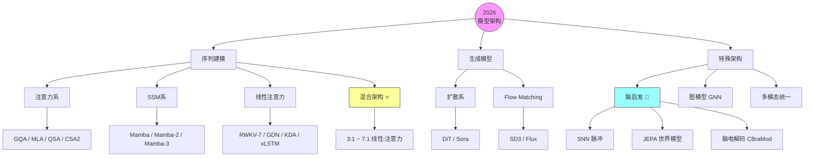

# 大模型架构全景（2026 版）

> **类型**: 背景调研文档（非论文事实来源）
> **起草**: 2026-10-16
> **用途**: 为「幻脑」路线（`docs/ROADMAP.md`）提供架构层参考；为「四大组件×脑机制」框架提供技术候选池
> **口径说明**: 文中数字为公开技术报告口径，未经本仓库实验复现

---

## 目录

- [一、总览：设计空间不是一条线，而是多维网格](#一总览设计空间不是一条线而是多维网格)
- [二、序列建模范式（四大流派）](#二序列建模范式四大流派)
- [三、稀疏化与效率](#三稀疏化与效率)
- [四、架构组件创新（顶级实验室的暗牌）](#四架构组件创新顶级实验室的暗牌)
- [五、生成模型架构](#五生成模型架构)
- [六、脑启发架构](#六脑启发架构)
- [七、DeepSeek V4.1 专题](#七deepseek-v41-专题)
- [八、混合架构专题（2026 主流）](#八混合架构专题2026-主流)
- [九、设计空间全景图](#九设计空间全景图)
- [十、对幻脑路线的意义](#十对幻脑路线的意义)

---

## 一、总览：设计空间不是一条线，而是多维网格

Transformer 只是**一个组合点**，不是整个空间。完整的模型设计空间有四个正交维度：

| 维度 | 内容 | 选择项 |
|------|------|--------|
| **① 序列混合原语** | 怎么处理序列 | 注意力 / 卷积 / SSM / 递归 / 检索 |
| **② 学习范式** | 怎么学 | 生成式 / 预测式 / 能量式 / 对比式 |
| **③ 计算基底** | 跑在哪 | 数字 GPU / 神经形态 / 量子 |
| **④ 结构基元** | 什么粒度 | 层 / 神经元 / 连接组 |

**组合空间 ≈ 5 × 4 × 3 × 3 = 180 格**，人类目前只探索了不到 **10 格**，且在轴上分布极不均匀（几乎全部集中在"注意力 + 生成式 + 数字GPU + 层"这一格及其邻域）。

---

## 二、序列建模范式（四大流派）

### 2.1 注意力系（Transformer 家族）

**基础注意力变体谱系**：

| 变体 | 全称 | 代表 | 核心收益 |
|------|------|------|---------|
| MHA | 多头注意力 | 原始 Transformer | 基准 |
| MQA | 多查询注意力 | PaLM | ~32× 省 KV |
| **GQA** | 分组查询注意力 | Llama 4、Gemma 4 | ~8× 省 KV（当前标配）|
| **MLA** | 多头潜在注意力 | DeepSeek V3/V4 | 压缩到潜空间 |
| **SWA** | 滑窗注意力 | Gemma 3、Mistral | 局部窗口 |
| **NSA** | 原生稀疏注意力 | DeepSeek 系 | 动态稀疏 |
| **QSA** | Qwen 稀疏注意力 | Qwen3.8 | 仅关注重要位置 |
| **CSA2** | 压缩稀疏注意力 2 | DeepSeek V4.1 | 890 字节/token |
| DSA | DeepSeek 稀疏注意力 | DeepSeek V4.1 | 稀疏索引 |

### 2.2 状态空间模型（SSM）

**演进史**：

```
S4 (2021) → Mamba (2023) → Mamba-2 (2024) → Mamba-3 (2026)
                                              ↑ "为推理而生"
```

**Mamba-3 三大改进**（2026-03）：
1. **复数值状态更新**——比 Mamba-2 表达力更强
2. **推理优先设计**——解码速度超 Transformer
3. 完全开源

### 2.3 线性注意力 / RNN 复兴

| 架构 | 特点 | 2026 状态 |
|------|------|----------|
| **RWKV-7** | RNN + 可并行训练 | ~7B 对标 Llama 3.1 8B |
| **xLSTM** | LSTM 现代化 | 工业应用 |
| **GDN** (Gated DeltaNet) | 门控 delta 网络 | Qwen3.5+ 核心组件 |
| **KDA** (Kimi Delta Attention) | Kimi 版线性注意力 | Kimi K2.5+ |
| **Griffin** | 混合 RNN | Google |
| 门控短卷积 | LFM2 用这个 | 连 SSM 都不用 |

### 2.4 混合架构 ⭐（2026 真正主流）

**共识公式**：`线性层（便宜省内存） + 注意力层（精确检索）`

| 模型 | 配比 | 线性组件 | 注意力组件 | 总参/激活 |
|------|------|---------|-----------|----------|
| **Qwen3.8-Flash-Next** | 3:1 | GDN | Attention + QSA | 125B / 6B |
| **Kimi K2.5** | 3:1 | KDA | MLA | 1T / — |
| **Jamba** | 7:1 | Mamba | Attention | 52B |
| **Samba** | 交替 | Mamba | SWA | — |
| **Nemotron 3** | 混合 | SSM | Attention + MoE | 120B-A12B |
| **MiniMax-01** | 混合 | Lightning Attn | Softmax Attn | 456B / 45.9B |
| **LFM2.5** | 混合 | 门控卷积 | GQA | 8B / 1B |

**为什么 3:1 是甜点区**：线性层太多→质量损失；注意力层太多→太贵。帕累托最优带在 3:1~7:1。

---

## 三、稀疏化与效率

### 3.1 MoE（混合专家）

| 模型 | 总参数 | 激活 | 激活率 | 专家设计 |
|------|--------|------|--------|---------|
| DeepSeek V4.1 | 552B | 8B (prefill) / 16B (decode) | 1.5-3% | 1 共享 + 384 路由 |
| Qwen3.8-Flash-Next | 125B | 6B | 4.8% | — |
| Nemotron 3 Nano | 30B | 3B | 10% | — |
| Kimi K3 | 2.8T | — | 极稀疏 | — |
| Llama 4 Maverick | 400B | 17B | 4.3% | — |
| Mixtral 8x7B | 47B | 13B | 27.7% | top-2 / 8 experts |

**趋势**：总参数持续膨胀，激活参数持续收缩。

### 3.2 量化演进

```
BF16 → FP8 → FP4 (V4.1 KV 已用 FP4 E2M1 + E4M3 scale)
```

### 3.3 投机解码

- Draft 模型 + 验证（经典方案）
- **DSpark**（DeepSeek V4.1）：半自回归草稿 + 置信度调度验证

### 3.4 KV 缓存压缩谱系（DeepSeek 视角）

| 代际 | 字节/token | 压缩手段 |
|------|-----------|---------|
| V1 | ~390,000 | 无压缩 |
| V2 | ~120,000 | MLA |
| V3 | ~45,000 | MLA + FP8 |
| V3.2 | ~30,000 | + DSA 稀疏 |
| V4-Flash | ~3,600 | CSA + 更激进压缩 |
| **V4.1-Flash** | **890** | CSA2 + FP4 + 跨层复用 |

V4.1 比 V4-Flash 省 **4×**，比 V1 省 **437×**。

---

## 四、架构组件创新（顶级实验室的暗牌）

| 组件 | 提出者 | 作用 | 首用 |
|------|--------|------|------|
| **mHC**（流形约束超连接）| DeepSeek | 稳定残差连接（投影到受约束流形）| V4 系列 |
| **Engram**（条件记忆）| DeepSeek | 196B 稀疏记忆库（token 查表激活）| V4.1 |
| **MTP**（多 token 预测）| DeepSeek | 训练加速 | V3 |
| **Hybrid MTP** | Meta/Kimi | 推理加速 | — |
| **N-gram 嵌入** | Qwen | 51B 参数做词组级记忆 | Qwen3.8 |
| **Sparse Indexer** | DeepSeek | 层级化稀疏索引 | V4.1 |
| **CED**（因果编解码）| DeepSeek | 编码器-解码器分离，KV 投影复用 | V4.1 |

---

## 五、生成模型架构

### 5.1 扩散系

| 架构 | 代表 | 说明 |
|------|------|------|
| **DiT**（扩散 Transformer）| Sora、Flux 3 | 用 Transformer 做去噪网络 |
| **潜空间扩散** | SD 系 | 在潜空间操作，效率高 |
| **像素空间模型** | Iris | 直接像素空间，无潜空间 |

### 5.2 Flow Matching（取代传统扩散）

- **SD3**：DiT + Rectified Flow
- **Flux**：Flow Matching 新一代
- 趋势：Flow Matching > DDPM 采样

### 5.3 统一多模态

- **Janus**（DeepSeek）：理解+生成统一
- **Qwen-Image**：文生图+编辑

---

## 六、脑启发架构

| 方向 | 代表 | 机制 |
|------|------|------|
| **SNN**（脉冲神经网络）| SpiNNaker2、Loihi | 事件驱动，极低功耗 |
| **神经形态硬件** | BrainChip、IBM NorthPole | 存算一体 |
| **世界模型** | V-JEPA 2 | 预测表征而非重建 |
| **脑电解码** | CBraMod、LaBraM、EEGPT | Criss-Cross Transformer |
| **类脑记忆** | Engram | 稀疏查表激活 |
| **连接组计算** | FlyWire GNN | 真实神经接线图 |

**关键分水岭**：
```
旧路线：模仿神经元硬件（SNN）→ 难训练、生态弱
新路线：模仿表征学习机制（JEPA / Criss-Cross）→ 工程可行 ✓
```

---

## 七、DeepSeek V4.1 专题

### 7.1 总体设计：Causal Encoder-Decoder (CED)

```
传统 Transformer（40 层平铺）：
  Layer 1 → ... → Layer 40（每层维护自己的 KV）

V4.1 CED 架构：
  ┌── 20层 causal encoder ──┐  ┌── 20层 decoder ──┐
  │  处理输入，产生全局表示   │→ │  KV 从编码器投影  │
  └────────────────────────┘  └──────────────────┘
```

**激活参数**：prefill 仅 8B，decode 16B（整机 552B）。

### 7.2 五大核心创新

**① CSA2（第二代压缩稀疏注意力）**

每层分配三种静态模式：
- **Full**：完整注意力（仅 4 层：2/8/14/20）
- **Reindex**：复用其他层的 Top-K 索引
- **Reuse**：直接读别人的 KV（零成本）

**② FP4 KV 缓存**
- E2M1 格式 + 每 16 通道一个 E4M3 缩放因子
- 每 token 仅 **890 字节**

**③ SWA Bounded Replay**
- 滑窗 KV 丢失时只重放最近 n_win 个 token
- 持久缓存降到 V4-Flash 的 1/8

**④ Engram 条件记忆** 🧠
- 196B 参数稀疏记忆库
- token 查表：命中激活，未命中跳过
- **类比**：海马体情境记忆（线索触发式检索）

**⑤ mHC（流形约束超连接）**
- 修正残差连接稳定性
- Single-Pass 版本（更高效内核）

### 7.3 其他组件

| 组件 | 说明 |
|------|------|
| MoE | 1 共享 + 384 路由专家，每 token 激活 6 个 |
| DSpark | 半自回归草稿 + 置信度调度验证 |
| DeepSeek-ViT | 从零训练，2D-RoPE + 3×3 像素重排 |
| 推理力度控制 | 1-100 可调（成本↔精度）|

### 7.4 关键数字

| 指标 | 数值 |
|------|------|
| 骨干参数 | 552B |
| 激活参数 | 8B（prefill）/ 16B（decode）|
| Engram 记忆 | 196B（稀疏）|
| 上下文 | 100 万 tokens |
| 训练数据 | 45T tokens |
| KV 缓存 | 890 字节/token |
| 层结构 | 20 编码 + 20 解码 |

---

## 八、混合架构专题（2026 主流）

### 8.1 核心权衡

```
注意力（Attention）：
  ✅ 精确检索全上下文
  ❌ O(n²) 计算，KV 缓存爆炸

线性层/SSM：
  ✅ O(n) 线性，固定内存
  ❌ 检索模糊

混合架构：
  ✅ 取两者之长，工程可行
```

### 8.2 装配位置

```
混合 Transformer 块：
┌─────────────────────────────┐
│ ① 序列混合器 ← 高频（3/4层）│  Mamba / GDN / KDA
├─────────────────────────────┤
│ ② 记忆模块 ← 旁路插入       │  Engram 查表
├─────────────────────────────┤
│ ③ 计算模块 ← 替换 FFN       │  MoE 稀疏专家
├─────────────────────────────┤
│ ④ 域注意力 ← 低频（1/4层）  │  精确检索
└─────────────────────────────┘
```

### 8.3 CSA2 三种模式（V4.1 核心）

| 模式 | 层数 | 行为 |
|------|------|------|
| Full | 4 层 | 完整计算自己的 KV |
| Reindex | 若干 | 复用其他层索引 |
| Reuse | 其余 | 零成本读取 |

### 8.4 混合架构设计谱系

```
Kimi Linear (2025) → MiniMax-01 → Qwen3.5 (GDN 3:1)
    → Qwen3.8-Flash-Next (成熟) → DeepSeek V4 (CED+CSA)
    → V4.1 (CSA2, 890 字节/token)
```

---

## 九、设计空间全景图



### 已探索格子的定位

| 组合 | 序列原语 | 学习范式 | 代表 |
|------|---------|---------|------|
| 主流区 | 注意力 | 生成式 | GPT / Claude / DiT |
| 混合区 | 混合 | 生成式 | Qwen3.8 / V4.1 / Kimi |
| 非注意力区 | SSM/RNN | 生成式 | Mamba-3 / RWKV-7 |
| JEPA区 | 注意力 | 预测式 | V-JEPA 2 / Signal-JEPA |
| 神经形态区 | 脉冲 | 事件驱动 | SNN 系 |

**空白最大**：非注意力的预测式架构（右上角）。

---

## 十、对幻脑路线的意义

### 10.1 四大组件 → 技术候选池

Roadmap 中的「四大组件×脑机制」框架，其技术候选可直接引用本文：

| 组件 | 本文对应章节 | 技术候选 |
|------|-------------|---------|
| ① 序列混合器 | §2.2-2.3 | Mamba-3 / GDN / KDA / RWKV-7 |
| ② 记忆模块 | §4 | Engram / N-gram 嵌入 |
| ③ 计算模块 | §3.1 | MoE（384 专家级设计）|
| ④ 域注意力 | §2.1, §7.2 | Criss-Cross / QSA / CSA2 |

### 10.2 三个可类脑解读的架构机制

| 架构机制 | 脑机制假设 | 验证数据（桶内）|
|---------|-----------|----------------|
| Engram 稀疏记忆 | 海马体情境记忆 | CineBrain 时序 |
| MoE 专家分工 | 皮层功能分区 | FlyWire 连接组 |
| Mamba/GDN 递归状态 | 工作记忆（前额叶）| Steinmetz 尖峰 |
| Criss-Cross 时频 | 脑电节律耦合 | THINGS-EEG |

### 10.3 三层类脑性论证

| 层级 | 论证 | 代表架构 |
|------|------|---------|
| **表征层** | 大脑预测抽象表征而非原始信号 | JEPA 更类脑 |
| **能耗层** | 大脑仅 20W，稀疏脉冲 | SNN 更类脑 |
| **结构层** | 大脑是连接组网络 | GNN 更类脑 |

### 10.4 研究命题

> 混合架构用「线性层压缩 + 注意力检索」模拟了大脑「记忆保持 + 情景提取」的分工——**这个分工能否在神经数据上找到对应？哪个组件的脑对齐贡献最大？**

---

## 附：主要参考来源

| 主题 | 来源 |
|------|------|
| DeepSeek V4.1 | 技术报告 arXiv:2609.19969；模型卡片 [deepseek-ai/DeepSeek-V4.1-Flash](https://huggingface.co/deepseek-ai/DeepSeek-V4.1-Flash) |
| mHC | arXiv:2512.24880 |
| DeepSeek V4 | arXiv:2606.19348 |
| Mamba-3 | arXiv:2603.15569 |
| Qwen3.8 | [qwen.ai/blog?id=qwen3.8-flash-next](https://qwen.ai/blog?id=qwen3.8-flash-next) |
| 架构全景 | [Sebastian Raschka LLM Architecture Gallery](https://sebastianraschka.com/llm-architecture-gallery/)（110 模型）|
| LFM2 | arXiv:2511.23404 |

---

*本文档为背景调研，非论文事实来源；论文口径一律以 `docs/research_paper/reconstruct.*` 为准。*
