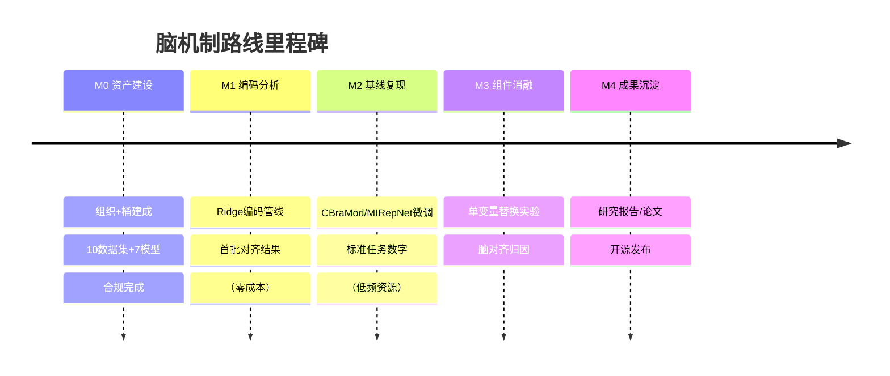

# 研究路线图 — 从异构融合到脑机制模拟

> **状态**: 方向规划文档（草案），非论文事实来源
> **起草**: 2026-10-16
> **定位**: 本项目的延伸方向 —— 把「异构融合」的技术积累用于「人脑机制模拟」研究
> **资产入口**: [illusion-brain/training-data](https://huggingface.co/buckets/illusion-brain/training-data)

---

## 0. 这条路线的由来

本项目（Hetero-MoE）的长期研究过程中形成了两条与"脑"相关的线索：

1. **v34（原 DMN 路线）**: 曾以默认模式网络（DMN）为设计灵感，后在论文中按要求移除全部神经科学术语——「神经科学类比是设计灵感，不是验证标准」（设计原则 #3）。
2. **逆向问题**: 如果把脑机制从"灵感"升格为"验证目标"——让模型不仅借脑的比喻，而是接受脑数据的检验——会得到什么？

本路线图回答第 2 个问题。它与主线的关系不是替代而是**互补的验证维度**：

| 维度 | 主线（Hetero-MoE） | 本路线 |
|------|-------------------|--------|
| 验证标准 | fuse MSE、样本外复验 | 脑对齐分数（RSA/编码预测）|
| 神经类比的地位 | 设计灵感，不是验证标准 | **脑机制本身作为验证目标** |
| 对象 | 跨模型融合（冻结底座）| 大模型表征 ↔ 脑响应 |
| 继承的纪律 | 样本外协议、5 种子配对、负结果地图、单组件可分解 | 同左 |

---

## 1. 两个核心问题

| 编号 | 问题 | 层级 |
|------|------|------|
| **Q1** | 大模型的内部表征在多大程度上与脑响应对齐？ | 表征层 |
| **Q2** | 把脑机制作为设计约束，能否改进模型架构？ | 架构层 |

两条问题互为支撑：Q1 提供测量工具（脑对齐分数），Q2 提供设计假说（类脑改造）。**注意**：Q2 的输出若用于主线，仍须通过主线的样本外协议检验，不因"类脑"而豁免。

---

## 2. 已建成的资产（截至 2026-10-16）

### 2.1 基础设施

| 资产 | 位置 | 状态 |
|------|------|------|
| HF 组织 | `illusion-brain` | ✅ |
| 数据桶 | `illusion-brain/training-data`（~113 GB / 36,848 文件）| ✅ |
| 合规层 | 6 种许可证全文 + 逐资源署名（ATTRIBUTION.md）| ✅ |

### 2.2 数据资产（10 组数据集）

```
training-data/
├── eeg/                # ⚡ 脑电：things-eeg (26.5GB), eeg-image-decode
├── fmri/               # 🧠 磁共振：fmri-shape (fMRI→3D)
├── multimodal/         # 🎬 多模态：cinebrain (fMRI+EEG+ECG, CVPR 2026)
├── spikes/             # ⚡ 电生理：steinmetz-spikes (Neuropixels)
├── connectome/         # 🪰 连接组：flywire (139k 神经元全脑)
├── model-features/     # 🤖 大模型特征：algonauts-2025 (57.6GB, 7 种模型)
└── benchmarks/         # 📏 小模型基准：sleep-staging, seizure-detection, motor-imagery
```

### 2.3 模型资产（7 个开源小模型）

| 模型 | 参数 | 专长 |
|------|------|------|
| MIRepNet | 5.1M | 运动想象专用 |
| CBraMod | 4.9M | 通用 EEG（ICLR 2025）|
| LaBraM | 5.8M | 通用 EEG（ICLR 2024）|
| BIOT | 3.4M | 通用 18 通道 |
| EEG-DINO-small | 4.5M | 自蒸馏 |
| Signal-JEPA | 3.5M | JEPA 自监督 |
| BrainTokenizer | 6.1M | EEG/MEG 分词器 |

---

## 3. 核心研究框架：四大组件 × 脑机制

### 3.1 组件化视角

继承主线的「可分解的异构性」原则，混合架构（2026 主流）可拆解为四类**可独立插拔的组件**：

```
混合架构 = ① 序列混合器 + ② 记忆模块 + ③ 计算模块 + ④ 域注意力
```

| 组件 | 技术候选 | 脑机制假设 | 验证数据 |
|------|---------|-----------|---------|
| ① 序列混合器 | Mamba / GDN / KDA / RWKV | **工作记忆**（前额叶持续活动）| Steinmetz 尖峰 |
| ② 记忆模块 | Engram / N-gram 嵌入 | **情景记忆**（海马体线索触发检索）| CineBrain 时序 |
| ③ 计算模块 | MoE 稀疏专家 | **功能分区**（皮层模块化）| FlyWire 连接组 |
| ④ 域注意力 | Criss-Cross 时频注意力 | **节律耦合**（时频交叉编码）| THINGS-EEG |

### 3.2 研究命题

> 混合架构用「线性层压缩 + 注意力检索」模拟了大脑「记忆保持 + 情景提取」的分工——**这个分工能否在神经数据上找到对应？哪个组件的脑对齐贡献最大？**

### 3.3 组件级归因实验设计

```
对每个组件做单变量替换（继承主线的一 flag 消融习惯）：
  基线: CBraMod (标准注意力)
  实验: 换成 Mamba 线性层 → 测脑对齐分数的变化
        加 Engram 式查表 → 测长序列记忆任务
        小 MoE vs 单 FFN → 对比功能分区指标
```

---

## 4. 实验阶梯（基于现实资源约束）

### 资源现实

| 资源 | 规格 | 状态 |
|------|------|------|
| 本地工作区 | 4 核 CPU / 14GB RAM / 245GB 磁盘 | ✅ 免费 |
| HF Jobs | T4 $0.40/h 起 | ❌ 余额 $0 |
| HF ZeroGPU | H200，3.5 分钟/天 | ⚠️ 太短 |
| 魔搭 Notebook | 100h 免费额度（待验证）| ❓ |
| AutoDL | ¥1.58-1.88/h（学生价）| 💰 备用 |

### Tier 0：编码对齐分析（零成本，即刻可做）⭐

| 项目 | 内容 |
|------|------|
| **数据** | eeg-image-decode（EEG 数据 + ViT-H-14 特征**已预提取**）|
| **方法** | Ridge 回归编码（特征→脑响应）+ RSA 表征相似性矩阵 |
| **算力** | 纯 CPU，分钟~小时级 |
| **产出** | 模型特征对脑响应的预测分数 R²；表征几何对比 |

### Tier 1：小模型微调基线（¥10 级）

| 项目 | 内容 |
|------|------|
| **模型** | CBraMod (4.9M) / MIRepNet (5.1M) |
| **任务** | motor-imagery (BCI IV-2a) |
| **平台** | 魔搭免费额度优先，AutoDL 备用 |
| **产出** | 小模型在标准任务上的基线数字 |

### Tier 2：完整扫描 + 组件消融（¥50-100，视结果决定）

| 项目 | 内容 |
|------|------|
| **规模** | 7 模型 × 3 任务 ≈ 30-40 GPU 小时 |
| **实验** | 组件替换（Mamba 换注意力）等单变量消融 |
| **产出** | 「小模型 vs 大模型」对比表 + 组件级脑对齐归因 |

---

## 5. 里程碑规划



| 里程碑 | 判据 | 成本 |
|--------|------|------|
| **M0** ✅ 已完成 | 桶可访问、合规完整 | 0 |
| **M1** 编码分析 | 得到第一个「特征→EEG」预测分数 | 0 |
| **M2** 基线复现 | 小模型在 benchmark 上有可对比数字 | ¥10 级 |
| **M3** 组件消融 | 至少 1 个组件的脑对齐归因结论 | ¥50-100 |
| **M4** 成果沉淀 | 文档/报告/论文 | 时间成本 |

---

## 6. 方法论纪律（继承主线）

1. **样本外纪律**：任何结论必须在 held-out 评估下复验（v47 教训）
2. **种子配对**：所有数字 5 种子均值 + 配对差异
3. **负结果地图**：失败实验同样记录——边界比中心更有信息量
4. **组件可分解**：每个实验只改一个变量，一 flag 可切换
5. **诚实归因**：收益来源必须可分解（v32 泄漏审计的教训）

---

## 7. 近期行动项

| # | 动作 | 负责 | 状态 |
|---|------|------|------|
| 1 | 确认魔搭 Notebook 免费额度 | 用户网页确认 | ⏳ |
| 2 | 搭建 Tier 0 编码分析管线 | AI 代劳 | ⏳ 待启动 |
| 3 | 跑通第一个 Ridge 编码实验 | AI 代劳 | ⏳ |
| 4 | 根据结果决定 Tier 1 是否启动 | 共同决策 | ⏳ |

---

*本路线图随研究进展持续更新；论文事实一律以 `docs/research_paper/reconstruct.*` 为准，本文档仅为方向规划。*
