# Microbiosis 个人主页 — 结构与口径核对

> 站点:`https://tgxd3ewysnxwu.space.mcode.cn`(node `445209760493908`)
> 源码:`.personal-site-staging/index.html`(单文件,不入构建流程)
> 本文档性质:**站点侧的说明 + 站内数字与本仓库现状的核对结果**,非权威研究规范。
> 核对日期:2026-10-15 · 核对基线:工作区未提交状态(见 §7)

---

## 一句话

站点是**完全自包含的单文件静态站**:一个 `index.html`(96 KB / 2088 行),
零外部请求——无 JS 库、无 CSS 框架、无 webfont(favicon 是 data URI,字体走系统栈)。
发布时把 `.personal-site-staging/` 目录整体上传即可,产物即源码。

---

## 1. 文件体检

| 项 | 值 |
|---|---|
| 文件数 | 1(`index.html`) |
| 体积 / 行数 | 96,102 B / 2088 行 |
| 行尾 / BOM | LF / 无 BOM(与仓库一致) |
| `<style>` | L9–1141,单块内联,420 条规则,占全文 54% |
| `<script>` | L2057–2085,IIFE,29 行,**仅实现滚动显现** |
| 外部资源请求 | 0(`src=` / `rel="stylesheet"` 命中数 = 0) |
| 断点 | ≤1249 / 768–1240 / ≤767 / ≤420 + `prefers-reduced-motion` |
| keyframes | 2(`hero-enter`、`monogram-enter`) |
| 外部链接 | 15 处,见下 |

外链分布:GitHub 仓库 ×7、`orcid.org` ×3、ModelScope ×2、Hugging Face ×2、GitHub 个人页 ×1。

---

## 2. 页面结构

```mermaid
graph TD
  A["head L3–8 · title / description / data-URI favicon"] --> B["style L9–1141 · 单块内联 CSS"]
  C["body L1142"] --> D["nav.site-nav L1149 · #top #projects #about #contact"]
  C --> E["section#top.intro-shell L1162–1348"]
  C --> F["section#projects L1350–1772"]
  C --> G["section.dark-section#about L1774–2021"]
  C --> H["footer#contact L2023–2055"]
  C --> I["script L2057–2085 · scroll-reveal"]
  C --> X[".site-toast L1144 · 有 markup + CSS,无 JS 触发"]

  E --> E1["hero-grid · 7 张卡"]
  E1 --> E11["01 identity L1171 · SVG 标识 + h1"]
  E1 --> E12["02 intro L1222 · 简介 + meta + CTA"]
  E1 --> E13["03 signal L1245 · FIELD NOTE"]
  E1 --> E14["04 resume L1255 · ORCID"]
  E1 --> E15["05 skills L1266 · 4 组能力"]
  E1 --> E16["06 hero-project L1277 · v39 预览"]
  E1 --> E17["07 explore L1340 · 3 条索引"]

  F --> F1["project-fusion L1357 · 融合"]
  F --> F2["project-routing L1486 · 中枢"]
  F --> F3["project-scale L1606 · 规模 · id=project-scale"]
  F --> F4["all-work-card L1699 · 合作桥"]

  G --> G1["practice-summary L1781"]
  G --> G2["capability-grid L1787 · 4 卡"]
  G --> G3["identity-band L1840 · 学术/开发身份"]
  G --> G4["about-grid L1932 · 文案 + 流程图"]

  H --> H1["contact-card L2024"]
  H --> H2["footer-grid L2033 · 3 卡"]
```



---

## 3. 三个项目行

| # | 标题 | 交付物(站内) | 关键数字(站内) | 图版内容 |
|---|---|---|---|---|
| 01 | 融合 | v6 baseline + 测试矩阵 | v6 → v10 → v13,最强教师 v13 mixture | BERT/LLaMA/ViT 汇入 mixture 层 |
| 02 | 中枢 | 4 mode · 7 个负结果 | gate-style **+88%**,softplus +3.0%,grad-scale +1.9% | attention → central → gate-style |
| 03 | 规模 | v33→v39 · 70 PASS | 1× 大 + N× 小 | 容器调度扇出 |

三张图版共用 `.editorial-visual / .editorial-stage / .editorial-feature / .editorial-foot`
结构,SVG 全部内联;12 个渐变/图案 id(`bgGrad`、`fusionBg`、`scaleImgBg` 等)全局唯一,无冲突。

---

## 4. 设计系统

17 个 CSS 变量,冷峻版调色:

- 底:`--paper #e7e9e7` / `--paper-strong #e2e4e2` / `--paper-soft #ebede9`
- 墨:`--ink #181c1f` / `--ink-soft #2a2f33` / `--muted #6b7077`
- 强调:`--blue #2c5fe6`(融合)/ `--blue-deep #1a47bf` / `--saffron #ecb53a`(通过态)/ `--teal #1f8a8c`
- 反色段:`--dark #0b0d0e` / `--dark-soft #14171a` / `--dark-line` / `--dark-muted`
- 缓动:`--ease-out cubic-bezier(.22,1,.36,1)`

排版只有一处 `font-family` 声明(系统栈),SVG 内文字用内联 `Arial` 属性。

---

## 5. 数字口径核对(站点 vs 仓库)

以 `README.md`(已修改、未提交)与 `research/**/tests/test_package.py` 为权威来源。

| 站内表述 | 位置 | 仓库口径 | 结论 |
|---|---|---|---|
| 8 条研究线 | L1225 / L1916 | 8 条(routing_evolution / central_diagnostics / central_stability / aligner / distillation / multimodal / corpus_scale / scale_heterogeneous) | ✅ 一致 |
| 规范基线 v4.0 冻结 | L1223 | 规范基线 v4.0 Final(冻结) | ✅ 一致 |
| **327 项 V&V 测试** | L1225 / L1478 | **430 / 430 ALL GREEN** | ❌ **过期 103 项** |
| **327 / 327 V&V 测试通过** | L1923 | 430 / 430 | ❌ **过期** |
| **v4.0 冻结 / v39** | L1233 / L1922 / L1943 | 工程实现 v4.0 → **v40**;仓库最新版本 **v47** | ❌ **落后 8 个版本** |
| **下一步 / v39**、`<h2>v39</h2>` | L1325 / L1333 | 同上 | ❌ 作为"最新"已过期 |
| v33→v39 · 70 PASS | L1617 | scale_heterogeneous 线 v33–v39,10×7=70 PASS | ✅ 一致 |
| 研究线 #8 / scale_het | L1690 | 线 8 = scale_heterogeneous(v33–v39) | ✅ 一致 |
| CONTAINER PARADIGM · v33→v39 | L1295 | 同上 | ✅ 一致 |
| v6 baseline + 测试矩阵 | L1368 | v6 baseline | ✅ 一致 |
| 最强教师 v13 mixture,优于 attn 与 linear | L1476 | v13 mixture fuse 0.26(**-77%**)← 教师当前最强 | ✅ 一致 |
| gate-style +88% | L1509 | routing_evolution:v7→v8→v9,gate-style 中枢 +88% | ✅ 一致 |
| softplus +3.0% / grad-scale +1.9% | L1511 | central_stability:v22→v30→v31 | ✅ 一致 |
| 单教师 +47.5% | L1271 / L1816 | distillation:单教师蒸馏可超教师 +47.5% | ✅ 一致 |
| 多教师全部退步 | L1271 / L1816 | distillation:多教师反而退步 | ✅ 一致(但缺 v40 补充口径,见下) |
| 4 mode · 7 个负结果 | L1497 | v44 为**四种**中枢模式容量-泄漏审计;README 设计哲学 #2 记 7 个负结果 | ✅ 一致 |
| BERT+ViT / 真实语料稳定性 | L1272 | multimodal 线 v21/v23/v24 | ✅ 一致 |

### 430 的构成(逐项加总,静态统计)

| 来源 | 数量 |
|---|---|
| `research/**/tests/test_package.py` 的 `TESTS` 条目(38 个包) | 359 |
| `tests/*.py` 内直接 `def test_`(fusion 7 / train_infer 7 / span_router 6 / losses 6 / router 6 / quant 6 / rerank_span 5 / seq_router 4 / 7_1–7_3 各 1) | 50 |
| `archive/negative_findings/v12_compose` | 8 |
| `archive/negative_findings/v23b_hard_vqa` | 8 |
| `archive/pre_baseline/v5_alpha` | 5 |
| **合计** | **430** |

`tests/` 下 52 个文件中有 42 个是**薄转发层**(thin forwarder),只 `from research....test_package import TESTS`,
权威副本在 `research/<line>/<pkg>/tests/test_package.py`;统计测试数必须数后者,数 `def test_` 只会得到 50。

### 站内缺失、仓库已有的结论

- **v40**:分派式多教师,README 结论为「分派只治伤害不治增益」。站内"多教师失败分析"只讲到负结果,没有这条。
- **v41–v47**:容量审计、多模态泄漏审计、中枢审计、hub modes 审计、规模边界审计、attn 路径审计、样本外审计。
  v47 一次性挖出五个此前无人发现的缺陷(v12/v19/v35 的 runner 从未真正跑起来等),已修复——**这是比"430 全绿"更强的故事**,站内没有。
- **泄漏审计 41/41 结清**、**包完整性 41/41 零错误零警告**:站内完全未提。

---

## 6. 改动落点表

| 想改什么 | 改哪一行 |
|---|---|
| 标题 / 描述 | L6 / L7 |
| 主标语 | L1215 |
| 简介正文与数字 | L1225、L1226–1239 |
| FIELD NOTE | L1247–1250 |
| ORCID / 身份 | L1258–1262、L1870–1926 |
| 四组研究能力 | L1268–1273 |
| v39 预览文案 | L1324–1328、L1333 |
| 三个项目描述与交付物 | L1360–1372 / L1489–1501 / L1609–1621 |
| 项目图版关键数字 | L1475–1479 / L1507–1512 / L1627–1632 |
| 四张能力卡 | L1789–1836 |
| 合作 CTA 与页脚 | L2024–2053 |
| 配色 / 间距 / 断点 | L10–26(变量)、L9–1141 其余 |
| 增删整张卡片 | 复制或删除对应 `<article class="hero-card …">` 整块,栅格自动重排 |

---

## 7. 待处理问题

### P0 — `archive/` 已从工作区删除,但 git 仍跟踪

```
git status --porcelain  →  ' D' × 28,全部位于 archive/
```

`git ls-files archive/*` 仍返回 28 个受跟踪文件,而 `E:\hetero-moe\archive\` 在磁盘上不存在。
直接后果:`tests/test_v5_alpha.py`、`tests/test_v12_compose.py`、`tests/test_v23_vqa_hard.py`
三个转发层会 `ModuleNotFoundError: No module named 'archive'`(它们分别 import
`archive.pre_baseline.v5_alpha` / `archive.negative_findings.v12_compose` / `archive.negative_findings.v23b_hard_vqa`)。
**也就是说,当前工作区状态无法复现 README 声称的 430/430 ALL GREEN**,实际可达上限是 409。

同时 `pyproject.toml` 的 `[tool.setuptools.packages.find] include` 仍列 `archive*`,README §项目结构
仍在描述该目录。删除尚未提交——**是否恢复属用户决策,本文档不代为操作**。

### P1 — README 内部数字不一致

| 位置 | 表述 |
|---|---|
| L12 | **430/430** ALL GREEN ✓(52 个测试文件) |
| L43 | `tests/` # **430** 个 V&V 测试 |
| L99 | `bash run.sh test # 全部 **430** V&V 测试` ✅已修 |
| L117 | 测试 \| **430/430** ALL GREEN ✓ |
| `run.sh` | 实测 **430/430**,52 个测试文件 |

L99 的 383 曾是唯一一处旧值,与同文件其余三处及 `run.sh` 均不符。

> ✅ **已修复(2026-10-16)**:L99 已统一为 430。同批清掉的还有
> `PAPER_README.md:156`(273 → 430)与 `response_letter_draft.md` L16/25/26/146(273 → 430);
> 后者「36 v-numbered experiments」按实测口径改为 **40 个唯一 v 编号**(examples/ 下共 53 个脚本,
> 其中 10 个有 `run.sh v{N}` 子命令,其余直接 `python3 examples/run_v{N}_*.py` 运行)。
> 另修正 4 个包 docstring 与实际测试条目不符:v22 12→**14**、v30 8→**9**、v42 8→**10**、v34 10→**13**。
> 430 的构成已实测核对:41 个转发层 380 项 + 11 个基础包 50 项。
> 注:本机因缺 `transformers` 与模型权重,有 11 个测试文件无法运行,故本机 `run.sh test`
> 实测为 321/321;缺口的 109 项补齐后即 430。

### P1 — 站内数字过期

327 → 430、v39 → v47(或至少 v40),见 §5。三处独立出现(首屏简介、研究 01 图版、身份带状态行),
改的时候要一起改,否则站内会自相矛盾。

### P2 — `.site-toast` 是悬空组件

L1144 有 markup,L937/L957/L958/L970 有 4 条 CSS 规则,但全站 JS 里**没有任何一处**会给它加
`.is-visible` 或写入文案。要么接上(如复制链接成功提示),要么删掉这 5 处。

---

## 8. 核对方法与未验证项

**方法**:全量读 `index.html`(结构、脚本、令牌、外链);以 `.NET` 目录枚举取得精确文件名;
对 `research/**/tests/test_package.py` 与 `archive/**` 静态统计 `TESTS` 条目与 `def test_`;
以 `git status --porcelain` / `git ls-files` / `git show HEAD:<path>` 取工作区与 HEAD 的差异。

**未验证(明确声明)**:

1. **没有执行测试套件**。430 是静态条目计数,不是跑出来的通过数;`torch` 环境未在本机运行,
   `bash run.sh test` 未执行。
2. **README 的 430/430 未被独立复现**,只验证了"测试条目数加起来确实是 430",以及
   `archive/` 缺失会导致 3 个转发层导入失败。
3. 站内**身份类信息无法用仓库核对**:`肇庆大学 · 旅游与历史文化学院 · 2025-09 至今`(L1881–1882)、
   `华为云微认证 ×2 · 2026—2028`(L1888–1889)——仓库里没有对应数据源,需要另行核实。
4. 站点**当前线上版本是否等于本地这份**未做对比(未拉取线上 HTML 与本地 diff)。
