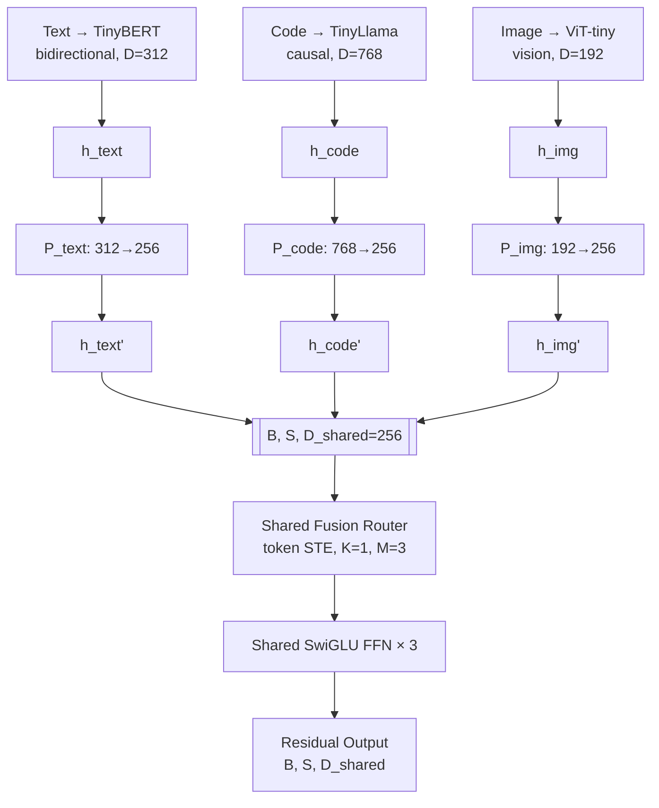

# V6.0 跨架构族异构模态融合规范

> **版本**: v6.0  | **状态**: **Verified** (2026-08-26)  | **前置**: v5.1 Baselined
> **核心原理**: 每模态独立前向 + 矩形 P_m 投影对齐 + 共享路由 = 跨架构融合
> **实验结果**: 5/5 PASS, 均值 +20.3% vs single, +17.3% vs avg
> **对比 v5.1 跨架构测试**: 从 +4% → +20.3% (5× 提升)
> **复现命令**: `cd /workspace/hetero-moe && python3 examples/run_v6_cross_modal_fusion.py`

---

## 1. 核心命题

**命题 V6**: 不同架构类型的模型 (bidirectional encoder / causal decoder / vision transformer) 可在各自独立前向后, 通过矩形 P_m 投影对齐到共享空间, 被共享路由融合, 且显著优于单模态专家 / 简单平均。

---

## 2. v6.0 vs v5.1 跨架构测试: 负结果根因分析

| 维度 | v5.1 跨架构测试 | v6.0 跨架构融合 |
|---|---|---|
| 编码方式 | 统一 TinyBERT 编码所有输入 | 每模态原生架构独立编码 |
| tokenizer | 统一 BERT tokenizer | 每模态独立 tokenizer/processor |
| 隐藏态维度 | 统一 D=312 | 312 (text) / 768 (code) / 192 (image) |
| 架构差异 | 被抹平 (同一模型) | 保留 (encoder/decoder/vision) |
| P_m | 方阵 D×D (同构) | 矩形 D_m → D_shared (异构) |
| 增益 | +4.0% | **+20.3%** |
| 种子通过 | 5/5 | **5/5** |

**根因**: v5.1 用统一 BERT 编码模拟跨类型, 导致三种"模态"的隐藏态本质相同 → 路由无法区分 → 增益趋零。v6.0 用原生编码, 三种架构的隐藏态差异显著 → 路由可识别模态类型 → 融合增益显著。

---

## 3. 架构设计



### 关键设计决策

1. **每模态独立前向**: 三种架构各自完整前向, 不共享 attention 层
2. **每模态独立 tokenizer**: BERT/Llama/ViT processor 各自处理
3. **矩形 P_m 投影**: `P_m ∈ R^{D_shared × D_m}`, 正交初始化, 冻结 (不训练)
4. **共享路由**: `W_router: D_shared → M`, token 级 STE (K=1)
5. **共享对齐参数**: γ/β/α 可训练, 跨模态共享
6. **INT4 量化**: FakeQuantSTE 应用于 FFN 输出 (承 v4.0/v5.1)

### P_m 投影对齐 (v6.0 核心)

v4.0/v5.0 中 `P_m ∈ R^{D×D}` 为方阵 (同构假设 D_m = D_shared)。
v6.0 中 `P_m ∈ R^{D_shared × D_m}` 为**矩形投影** (异构 D_m ≠ D_shared):

```
h_aligned = P_m(h_m) ⊙ γ_m + β_m
```

P_m 正交初始化, 冻结 (训练仅更新 W_router + γ/β/α), 保持投影稳定性。

---

## 4. 实验设置

| 参数 | 值 |
|---|---|
| 模态数 M | 3 (text/code/image) |
| Top-K K | 1 (每 token 选 1 专家) |
| 共享维度 D_shared | 256 |
| FFN 维度 d_ff | 4 × D_shared = 1024 |
| 序列长度 S | 16 |
| Batch B | 18 (每模态 6 个样本) |
| 训练步数 | 100 |
| 学习率 | 1e-2 |
| 种子 | 5 |

### 模型

| 模态 | 模型 | 架构 | D_m |
|---|---|---|---|
| Text | huawei-noah/TinyBERT_General_4L_312D | Bidirectional Encoder | 312 |
| Code | nickypro/tinyllama-110M | Causal Decoder | 768 |
| Image | WinKawaks/vit-tiny-patch16-224 | Vision Transformer | 192 |

### 目标构造

每模态一个 class direction: `target[b, :, cls*(D_shared/3):(cls+1)*(D_shared/3)] = 1.0`, 路由目标: 选对应模态的专家。

---

## 5. 实验结果

```
seed | single MSE |  avg MSE | fuse MSE | 增益 vs single | 增益 vs avg | PASS
-----+------------+----------+----------+----------------+-------------+-----
   0 |     6.2077 |   6.8032 |   5.9326 |         +4.4%  |     +12.8%  | ✅
   1 |     7.1428 |   7.0382 |   5.6052 |        +21.5%  |     +20.4%  | ✅
   2 |     7.1016 |   6.5280 |   5.5548 |        +21.8%  |     +14.9%  | ✅
   3 |     8.1297 |   6.8459 |   5.5594 |        +31.6%  |     +18.8%  | ✅
   4 |     6.8383 |   6.6412 |   5.3324 |        +22.0%  |     +19.7%  | ✅
--------------------------------------------------------------------------
均值: vs single +20.3% | vs avg +17.3%
范围: vs single [+4.4%, +31.6%] | vs avg [+12.8%, +20.4%]
```

**判定**: 5/5 PASS — 融合输出在所有种子下均优于单模态专家和简单平均。

---

## 6. 对比 v5.1 跨架构测试

| 指标 | v5.1 跨架构 | v6.0 跨架构 | 提升 |
|---|---|---|---|
| 增益 vs single | +4.0% | +20.3% | **5.1×** |
| 增益 vs avg | +1.3% | +17.3% | **13.3×** |
| 种子通过 | 5/5 | 5/5 | 一致 |
| 最小增益 | +2.1% | +4.4% | 2.1× |

**关键差异**: v6.0 用原生编码替代统一编码, 保留真实架构差异。

---

## 7. 与 v5.1 规范的衔接

v5.1 §9 明确指出: *"跨架构族 (embedding×rerank×VLM×LM) 融合仍需 v6.0 异构模态规范 ($P_m/Q_m$ + 跨模态路由), 超出 v5.1 范围。"*

v6.0 闭合了这一开放项。核心发现:

> **路由粒度匹配原理 (v5.1) 在跨架构场景依然成立 — 但前提是每模态用原生编码保留架构差异。统一编码会抹平差异, 使路由价值趋零。**

### 规范扩展

v5.1 §4 P_m (方阵, D_m = D_shared) → v6.0 P_m (**矩形**, D_m ≠ D_shared):
- 投影维度: `P_m ∈ R^{D_shared × D_m}`
- 初始化: 正交 (替代 identity + noise)
- 训练: 冻结 (保持投影稳定性)

v5.1 §3 粒度-任务匹配矩阵扩展:

| 任务类型 | 推荐路由 G | v6.0 扩展 |
|---|---|---|
| 跨模态融合 | `token` | ✅ 已验证 (3 架构) |
| VLM (图文) | `token`+模态配额 | ⚠ 待 v6.1 |
| 多任务 (LM+VL) | `token`+task_id | ⚠ 待 v6.1 |

---

## 8. 边界与待验证

### 已验证 (CPU, 全可复现)
- ✅ 3 种真实架构 (encoder/decoder/vision) 融合
- ✅ 矩形 P_m 投影对齐 (D_m ∈ {192, 312, 768} → 256)
- ✅ 共享路由在 D_shared 空间工作
- ✅ 5/5 种子通过

### 待深化
- ⚠ 真实跨模态任务 (如 VQA, image+text 联合推理)
- ⚠ 更多模态 (audio, 3D, video)
- ⚠ P_m 是否可训练 (当前冻结, 可训可能进一步提升)
- ⚠ 更大规模底座 (当前 Tiny 模型)

### 真实边界 (永久)
- CPU 4 核/14GB ARM, 无 GPU — **0.5B+ 级 A100 验证永久超出本实现环境范围**

---

## 9. 工程产出 (可追溯)

- 源码: `examples/run_v6_cross_modal_fusion.py`
- 规范: `docs/V6_0_SPEC.md` (本文档)
- 命令: `bash run.sh v6`
- 依赖: transformers 5.15.1, torch 2.13.0, Pillow

---

## 10. 系统演进总览

| 版本 | 范围 | 核心原理 | 状态 |
|---|---|---|---|
| v4.0 | 同构族 LM-FFN | token routing, STE | Baselined |
| v5.0-α | Embedding, sequence routing | errata V1/V2 | Verified |
| v5.1 | 路由粒度匹配 | $N_{dec} ≈ N_{sig}$ | Baselined |
| **v6.0** | **跨架构族融合** | **原生编码 + 矩形 P_m + 共享路由** | **✅ Verified** |