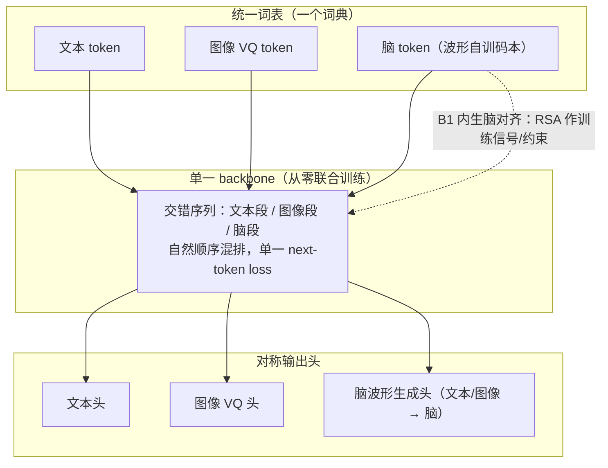

# 脑域线：模型形态判定书

> **状态**：方向判定文档（非论文事实来源）· 起草 2026-10-23
> **定位**：**脑域研究线自己的**形态判定与目标架构。与主线（Hetero-MoE 的跨模型融合）互不框定。
> **证据来源**：`FINDINGS_TIER0_RSA.md` §十六（7 基模脑对齐表，10/10 被试 / 20 Job 全绿；exp75 逐层语义承载曲线）。
> **适用范围**：`research/brain_domains/` 全线；本文档不约束主线，也不被主线的属性反向定义。

---

## 0. 判定原则：形态判定只能由本线自己的目标与数字给出

微软亚研的三层分类（多模态接口 / 多模态对齐与融合 / 原生多模态）与优图的两细分（mid-fusion / early-fusion）
是**通用的描述坐标系**，不是评分表。用它给一条研究线定形态时，有两个必须避开的错误：

| 错误 | 表现 | 纠正 |
|---|---|---|
| **借另一条线的属性** | 用主线的「跨模型融合 / 冻结底座」去定义脑域线的模型形态 | 形态判定用本线自己的**目标**与**实测数字** |
| **把工具阶段当系统形态** | 拿「脑编码器 + 冻结 + 线性读出」这一层的产物去回答「我们的模型将会是？」 | 先分清「这一层在造什么零件」与「这条线最终交付什么模型」 |

本文档的每一条判定后面都跟本线自己的数字，不引用主线的性质。

---

## 1. 两条线的分界（写清不混）

| 维度 | 主线（Hetero-MoE） | **脑域线**（本文档） |
|---|---|---|
| 交付物 | 跨模型融合架构：多个独立训练的模型的可插拔组合 | **脑原生模型** + 脑组件库 + 脑对齐度量体系 |
| 融合发生的层级 | 系统层 / 模型间：拼装已训好的模块 | **模型内**：同一套联合训练权重内部的部件替换 |
| 脑侧角色 | 待接入的模块供给方 | **原生模态**（可训、可读、可生成） |
| 验证标准 | fuse MSE、样本外复验、5 种子配对 | **脑对齐分数**（RSA / 编码 / 解码） |
| 递归的「可插拔」含义 | 多个冻结模型之间换 | 同一套权重内部换 block |
| 继承的纪律 | — | 样本外协议、5 种子配对、负结果地图、单组件可分解（**继承的是纪律，不是形态**） |

> 主线的「冻结底座」是主线的**工程选择**（让每个模块各自最优、组合可复验）；
> 它不是脑域线的形态标签，脑域线不以它为前提，也不以它为禁忌。

### 1.1 归属规则：每条结论归哪条线（本文件的硬规矩）

两条线**互不定义**（`docs/ROADMAP.md` 里主线的路线图从未提及脑域线，反之亦然）。
⇒ 本文件里出现的任何断言，必须能归到下面三类之一：

| 类别 | 判据 | 归属 | 例子 |
|---|---|---|---|
| **A. 脑域线的形态结论** | 只用**脑域线自己的目标（B1–B4）与自己的数字** | 本文件 | S1b 成立（离散层 +0.0344，10/10）；v3 的共享词典对应失败（5 臂跨模态码预测全随机）⇒「统一词表」形态**还没成立** |
| **B. 手段评估（跨线可复用）** | 评价的是**主线的语汇**（搬组件 / 对齐器 / 联合训练 vs 别的训练目标） | **主线**（线 4 aligner 语汇）；脑域线只是**借用**它做了一个脑侧实验 | §7.2：脑侧「搬组件 + 联合训练」相对「换训练目标」的增益几乎为零（注意力只买到离散层 +0.0102，三个 FFN 供体 ≈ 0；增益全来自语义监督 +0.020～+0.029） |
| **C. 外部参照** | 别人已发表的系统/数字 | **别人**（必须显式署名） | BrainJanus（ICML 2026, arXiv:2606.30319）；ATM（NeurIPS 2024）；LDNS（NeurIPS 2024）；fusion-based 的 200-way 检索表 |

⇒ **两条规矩**：
1. **B 类结论不得用来判定脑域线的形态**（那是主线的手段，换条线做同一个手段，结论未必同向）；
2. **C 类结论不得当成我们的结果**，只能当对照或参照（§7.3 里每条都标了出处）。

⚠️ **主线的语汇在脑域线里的位置**：「组件级组装」（搬一个底座的 block 进自己的骨架、两侧学投影、一起训练）
是**主线**的语汇（`research/aligner/` 的「异构底座怎么对齐语义空间」、`research/central_stability/` 的结构修复），
本线 §7.2 是**借用**它做的脑侧实验 ⇒ 它的结论归 B 类。
⇒ 本线自己的形态结论只取 A 类数字。

### 1.2 外部方法在这条线上的落点（避免再问「这条属于谁」）

| 外部方法 | 落点 | 理由 |
|---|---|---|
| **扩散模型（① 神经放电序列生成/补全）** | **脑域线的方向 B/C**（内放电数据：macaque/mouse），**不是** tier-0 EEG 线 | ① 吃的是 spike 序列；我们 tier-0 是 63 通道稠密 EEG |
| **扩散模型（② 神经信号→视觉刺激重建）** | **脑域线 tier-0 的 S2/S3**（脑侧编码器 + 图像侧生成先验） | 用的正是我们的 EEG + THINGS-EEG；**主线无此部件**（主线线 6 的多模态是 BERT+ViT 蒸馏，没有「视觉分支」） |
| **扩散模型（③ ControlNet 式条件生成）** | 同 ② | ⚠️ 这里的「视觉分支」= **脑域线里脑→图像那一侧**，**不是**主线的 ViT 专家 |
| **离散共享词表 / 自回归 next-token** | **脑域线 tier-0 的 S1b/S2**（§4 承诺的形态） | 主线全程无「词表」概念（主线对齐的是**表示空间**，不是**token 词典**） |

---

## 2. 脑域线自己的四条判据（B1–B4）

通用四条（统一词表 / 从零联合训练 / 原生交错单 loss / 输入输出对称）是**必要条件**，对「类脑」不充分。
脑域线另有自己的四条，因为脑域线要回答的是「一个模型怎样才算**脑的**，而不只是『用了 EEG 当输入』」。

| 编号 | 判据 | 本线为何必须有它（自有理由） | 现状（10 被试实测） |
|---|---|---|---|
| **B1 脑对齐内生** | 表征几何与脑响应几何对齐，且这个分数是模型内在属性 | 脑域线唯一的验证标准就是脑对齐分数；主线的 fuse MSE 测不到脑 | ✅ 度量体系齐（指标 A/B） ❌ 现有基模全冻结，且指标 B 全在随机水平 |
| **B2 脑结构承载** | 脑区/功能分工落在**结构**里（层 / block / 专家的分工），不落在输入标签里 | 方向 A 六个实验全否定：脑区标签**可解码但无下游增量价值** ⇒ 标签这条路已死，只能走结构 | ❌ 未做：现在只有「哪层有语义」的读数，没有「按功能分工的结构」 |
| **B3 可生长** | 脑侧参数在联合训练中被改写（可微更新），不是冻结后插上去 | 冻结的脑表征在本线的指标 B 上**全部落在随机水平**（见 §3）⇒ 本线自己的数字就否定了「脑侧只做读出」 | 🟡 组装路线上脑侧权重（**含嫁接进来的**）在联合训练中被改写，+0.0897 就是这么来的（§7.2）；但**图像侧仍是冻结特征** ⇒ 完整可生长要等 S2 |
| **B4 统一表征 + 脑侧对称** | 脑与图/文共享一个表征/词表；脑既能读出语义，也能被语义重建 | 脑域线要的是「脑是**模态**」，不是「脑是特征源」；只读不写，脑就仍是传感器 | 🟡 脑侧离散码本已现雏形（量化码 +0.0155，8/10 显著）；**S1b 后离散层已带语义**（one-hot +0.0344，10/10，§二十三），但**共享同一本词典**还差一步（学出来的码本未优于随机码本） |

---

## 3. 现状判定（本线的数字给出的，不含主线属性）

### 3.1 当前阶段在造什么

7 基模 + 冻结 + 线性读出这一层，**不是**脑域线要交付的多模态系统，而是**脑侧零件的解剖标本**：
它回答的是「脑的语义长在模型的哪一层、哪类训练目标会长出语义」。

⇒ 用微软/优图的三层去贴这一层是**分类错误**（把零件目录当系统形态）。

### 3.2 但脑域线自己的表同时给出一条硬约束

| 模型 | 指标 A：r_img（中位） | A 显著 | 指标 B：acc1 | B ×随机 |
|---|---|---|---|---|
| **630-d 原始特征** | **+0.0504** | **10/10** | **0.0111** | **2.2×** |
| signal-jepa | +0.0260 | 9/10 | 0.0056 | 1.1× |
| braintokenizer | +0.0155 | 8/10 | 0.0059 | 1.2× |
| cbramod | +0.0105 | 7/10 | 0.0055 | 1.1× |
| eegdino-small | +0.0063 | 2/10 | 0.0052 | 1.0× |
| mirepnet | +0.0012 | 2/10 | 0.0054 | 1.1× |
| biot | +0.0007 | 5/10 | 0.0049 | 1.0× |

**指标 B 全部落在随机水平（1.0–1.2×），连 630-d 原始特征都做到 2.2×。**
⇒ 冻结的脑表征**装得下**图像语义结构（指标 A 显著），却**不以线性可读的形式保留**它。

**这条否定是脑域线自己跑出来的**（10 被试 / 20 Job 全绿），与主线冻不冻结底座无关：
**脑侧若只被当作冻结特征源，注定被原始特征打败。** ⇒ B3（可生长）不是偏好，是必要条件。

### 3.3 与通用三层的对应（只对「当前这一层」成立）

| | 通用分层 | 我们的位置 |
|---|---|---|
| 第 1 层 | 多模态接口：系统层调不同模型/API 拼能力 | **不是**（我们做的是模型级，不是 API 串联） |
| 第 2 层 | 多模态对齐与融合：编码器独立训练，投影后拼进主干 | **当前落点**（脑侧编码器独立预训练 + 只读出、无端到端、无差分学习率 ⇒ 这一层里偏弱的一种） |
| 第 3 层 | 原生多模态：从第一步起统一表征空间端到端联合训练 | **目标落点**（见 §4） |

### 3.4 一条容易搞错的事

**阶段 C/D 的逐 block 重组不改变层级。** 它搬的是已经训好的权重，
仍然没有端到端联合训练 ⇒ 重组完成后仍在第 2 层。
层级升级只能由 **S2（从零联合训练）**实现，不由组装实现。

---

## 4. 目标形态：**脑原生（brain-native）三模态 born-native**

一句话：**EEG 不是被投影进来的传感模态，而是与文本 / 图像共享同一离散词表、
同一个 next-token loss、同一套可训练权重的原生模态。**

对照通用四条，逐条给出脑域线的具体承诺：

| 通用判据 | 脑域线的具体形式 | 脑侧的新意（相对 Chameleon / Transfusion 家族） |
|---|---|---|
| 统一词表 | 波形 → 离散脑 token，与文本 / 图像 token **同一个词典**（不是投影过去） | **脑 token 的码本是从原始波形学出来的**，且取样层由 exp75 决定（§5.2） |
| 从零联合训练 | 脑编码器在联合训练中**可训练**，不是冻结外挂 | 更进一步：**脑码本可与文本码本联合演化**（Chameleon 的图像 VQ 是单独预训练后冻结）⇒ 脑域线最值得押的一注 |
| 原生交错单 loss | 脑段 / 图段 / 文段按自然顺序混排，**一个 next-token loss** | 交错次序需按脑侧信息密度设计（§5.2） |
| 输入输出对称 | 文本头 + 图像 VQ 头 + **脑波形生成头** | 脑不只是只读传感模态：**文本/图像 → 脑** 也要能生成 |

> 通用四条之外的第五条（**脑域线独有**）：对齐要**内生**（B1）——
> 脑对齐分数不能只在训练完外挂探针才算数，要能反过来当训练信号 / 约束用。

---

## 5. 目标架构（组件级）

### 5.1 骨架

### 5.2 脑侧的四个设计决定（全部来自 exp75，不是设计偏好）

| # | 决定 | 依据 |
|---|---|---|
| 1 | **脑 tokenizer 的取样层不能取最后一层** | cbramod 语义铺满 12 个 block、signal-jepa **只在第 0 层**（+0.0140, p=0.005，第 6 层显著为负 −0.0112 p=0.030）、mirepnet **藏在 FFN 内**（`transformer.1.1.fn` +0.0633, p=0.015）⇒ 「最后一层」代表不了「整个基模」 |
| 2 | **码本优先于连续特征** | braintokenizer 内部连续特征 **0 显著**，而**量化后**的 token 码 +0.0155（8/10 显著）⇒ **离散化本身造出语义对齐** |
| 3 | **重组宿主选 cbramod** | 语义铺满 12 层 ⇒ 拆得动、换得动，换掉一段不会丢失全部 |
| 4 | **供体取「唯一显著处」** | signal-jepa 第 0 层（唯一显著层）/ mirepnet 的 FFN / braintokenizer 的量化码 |

---

## 6. 阶梯 S1–S4（脑域线自己的）

| 级 | 内容 | 判据（可判） | 本线自带的对照基线 |
|---|---|---|---|
| **S1a** | **纯自监督** EEG 离散 tokenizer（掩码重建） | **重建层**的 RSA 显著 + 码本利用率高 | braintokenizer 的**重建输出**（+0.0155，8/10）—— 它的码本**不是**语义载体（见 §6.1） |
| **S1b** | **加语义监督**训码本（图文对比 / 图像条件重建） | **离散层**（码本向量 / one-hot）的 RSA 显著 ⇒ 「统一词表」才成立 | S1a 的离散层读出（实测**不显著**）✅ **已达成**（§6.2） |
| **S2** | 三模态联合训练（统一词表 / 交错序列 / 单 loss） | 脑-图、脑-文对齐（RSA）；文本/图像能力不塌 | 630-d 原始特征（指标 A +0.0504 / 指标 B 2.2×）与 7 基模冻结表征 |
| **S3** | 对称输出：加脑波形生成头 | 生成波形的可辨识度 / 重建；同一份 EEG 是否被压进更好的码本 | 无（首次） |
| **S4** | 单模态基线 + 涌现性检验 | 脑-only / 图-only / 文-only vs 联合模型；联合模型是否在单模态任务上超过单训模型 | 无（首次） |

每级都过主线的样本外纪律（5 种子配对、负结果地图、单组件可分解）——**继承纪律，不继承形态**。

### 6.1 为什么 S1 必须拆成 a / b 两级（2026-10-23 实测，10 被试）

S1a（纯自监督，掩码重建，K=1024，10 被试中位）的因果分解（`FINDINGS_TIER0_RSA.md` §二十一）：

| 读出 | A r（中位） | 显著被试 |
|---|---:|---:|
| **重建层**（量化→解码的重建 EEG） | **+0.0372** | **10/10** |
| 量化层（码本向量池化） | +0.0045 | 0/10 |
| 离散层（one-hot / 码号） | +0.0014 / +0.0002 | 0/10 / 0/10 |
| 对照 A（不量化的 encoder） | +0.0032 | 1/10 |
| 对照 B（随机码本 + 同 decoder） | +0.0021 | 1/10 |

⇒ **纯自监督学出来的 EEG 离散 token 本身不携带图像语义**；
语义来自「**学出的码本 + 学出的解码器**」这个回路。
⇒ Chameleon 的图像 VQ 之所以天生带语义，是因为「图像」自带语义；
**EEG 没有这个 ⇒ 纯自监督的脑码本不会带语义 ⇒ 统一词表必须靠语义监督（S1b）。**

⇒ 同时给出一条**现成的正结论**：S1a 的**重建层**是高质量脑信号表征
（**+0.0372、10/10 显著**，超过全部 7 个现成基模：signal-jepa +0.0260、
braintokenizer 重建输出 +0.0155、cbramod +0.0105；达到 630-d 原始特征 +0.0504 的 **74%**）
⇒ **可以立刻充当阶段 D 的新供体/宿主**（比 braintokenizer 强 2.4×）。

### 6.2 S1b 已达成，但「统一词表」还差一步（2026-10-23 实测，10 被试）

S1b 的做法：在自研骨架（D=64）里做**组件级组装**（嫁接 signal-jepa 第 0 层的注意力 +
一个 donor 的 FFN + 两侧学习投影），并把**语义损失挂在重建信号**上
（挂池化 token 上学不动 —— S1a 已证明池化 token 不带语义）。

| | 重建层 | 码本向量 | **离散 one-hot** | 连续（不量化） | **随机码本** |
|---|---:|---:|---:|---:|---:|
| S1a（纯自监督） | +0.0372 (10) | +0.0045 (0) | +0.0014 (0) | +0.0032 (1) | +0.0021 (1) |
| **S1b（嫁接注意力 + 语义监督）** | **+0.0897 (10)** | +0.0294 (10) | **+0.0344 (10)** | +0.0384 (10) | +0.0495 (10) |
| **S1b（不嫁接注意力 + 语义监督）** | **+0.0916 (10)** | +0.0221 (9) | **+0.0224 (10)** | +0.0197 (8) | +0.0149 (8) |
| 无语义监督对照臂 | +0.0309 (10) | +0.0058 (1) | +0.0055 (1) | +0.0040 (0) | +0.0012 (1) |

**逐被试配对 Δr**（只差语义监督这一个因子）：离散 one-hot **+0.0286，10/10，p=0.0010**
（不嫁接注意力的配方下同样成立：+0.0202，10/10，p=0.0010）。

⇒ **S1b 的判据达成**：**离散 token 的码字分布**与图像语义对齐（+0.0344，10/10；对照臂 1/10）。

⚠️ **但离「统一词表」还差一步，而且差在哪已经测清楚了**：
`emb_mean`（**学出来的**码本）与 `random_codebook`（**随机**码本，同 encoder / 同维度 / 同池化）
配对 Δr = **−0.0180（1/10）** ⇒ **学出来的码本没有比随机码本更语义**。

⇒ 即：**语义在连续表征 `z` 里，离散化只是顺带把它传过去**；
码本的几何至今只被**重建目标**组织（EMA 把码向量拉向分配给它的 z 的均值），
**从没被语义组织过**。
⇒ **唯一的正面线索**：**不嫁接注意力**的配方下，Δr(学出来的码本 − 随机码本) = **+0.0068（8/10，p=0.055）**
（唯一为正的臂，但未过 0.05）⇒ 下轮的基线配方应该是「不嫁接注意力 + 语义监督 + 码本按语义学」。
⇒ 硬门槛：**「学出来的码本」必须显著优于「随机码本」**（本轮两个配方都没过）。

#### 6.2.1 v3（共享词典）试过了：**「统一词表」还没成立，但失效机制定位清楚了

v3 试的是更直接的实现：图像侧先建一本离散词典（ViT-H-14 特征上的球面 k-means，K=1024），
EEG 的每个 token **直接预测**图像的码（跨模态码预测），并让码本吃语义梯度。

| 结果 | 数字 |
|---|---|
| 五个臂的**跨模态码预测**命中率 | **0.0008–0.0010（随机 0.00098）** ⇒ 全部随机水平 |
| 语义 CE | 6.91–8.27（随机 6.931）⇒ 压根没学 |
| 码本塌缩 | 码向量余弦 → +0.95、有效秩 → **1.1/64** |

⇒ **失效机制**（能定位到损失项的耦合）：
跨模态 CE 把 **z 拉向码** × 码本损失把 **码拉向 z** ⇒ 互相强化 ⇒ 一起塌
⇒ 塌掉的码本没有可分性 ⇒ CE 学不动。
⇒ 而 **`exp80` 的 EMA 机制原来是在防这个塌缩**（平滑平均不自激）⇒ 不能随便换成梯度更新。
⇒ 顺带把「学出来的码本不如随机码本」的原因也测清了（`exp88`）：
**码本有效秩只有 5.08/64**（1024 个码挤在 5 维子空间、彼此余弦 +0.138），
而随机码本是 60/64 各向同性 ⇒ **区分度不足**才是它落后于随机分箱的原因。

⇒ **由此改写的目标架构设定**（§5.1）：
**「统一词表」不能建立在「整图一个码」上** ——
若 EEG 的 31 个 token 全预测同一个图像簇 ⇒ 序列退化成单码 ⇒ 逐试次信息被抹掉
（而逐试次信息正是重建层 +0.0897 的来源：细节由 31 个 token 的**组合**承载）。
⇒ **统一词表要在位置级别成立**：图像侧用 **patch 级多个离散码**，
EEG 的时间片 token 与之对齐 ⇒ 这才接得上「EEG 段 / 图像段交错混排」的目标形态。
⇒ 下一步的三条具体改动（SwAV 式停梯度原型分配 / 均衡对象换成「簇↔码」/ 图像侧改 patch 级码）
见 `FINDINGS_TIER0_RSA.md` §二十四·四。

（数据与口径：`FINDINGS_TIER0_RSA.md` §二十三；`results/assembled-results/`。）

---

## 7. 阶段 C/D 在脑域线里的位置：**零件资格赛**

| | 内容 |
|---|---|
| **是什么** | 宿主 cbramod 的**最终表征** ⊕ 供体某层表征（表征级拼接），每个变体配一个**同名 shuffle 对照**（供体的图像对应关系被打乱、维度不变）；评价用指标 A（RSA）为主，指标 B 仅用于盯「有没有破坏已有对齐」 |
| **证明什么** | 哪些脑部件**带的信息是真实的**（变体显著优于自己的打乱对照），以及**接进宿主后是提升还是拉低**对齐 |
| **不证明什么** | 不证明原生性、不改变分层（§3.4）、不是最终架构；**也不等于权重级嫁接**（零训练下权重级嫁接已被判死，见下） |
| **与主线的重组有何不同** | 主线的重组是**多个冻结模型之间**换；脑域线的重组必须在**同一套联合训练权重内部**换 ⇒ 阶段 C/D 是这条路的**零件级证据**，不是终点 |

### 7.1 阶段 D 的实测结果（2026-10-23，10 被试 × 2 趟，20 Job）

| 供体 | exp75 的层内 RSA | 接入后 vs 宿主 | 资格赛结论 |
|---|---|---|---|
| **自训 tokenizer 的重建层**（S1a，K=1024） | +0.0372（自身） | **+0.0177，10/10 正，p=0.0010** | ✅ **最佳供体之一** |
| signal-jepa 第 0 层 | +0.0140 | **+0.0178，10/10 正，p=0.0010** | ✅ **完全通过**（与自训重建层几乎等量） |
| braintokenizer 的重建输出 | +0.0155 | +0.0057，7/10 正，p=0.172 | 🟡 部分通过 |
| mirepnet 的 FFN | **+0.0633（exp75 最强）** | **−0.0074，2/10 正** | ❌ **不通过**：接进去**拉低**宿主 |

**⇒ 两条对本阶梯有直接影响的结论：**

1. **「零件资格赛」不可省**：exp75 排第一的供体（mirepnet 的 FFN）接入后**最差**，
   而 exp75 排第三的 signal-jepa 清楚通过 ⇒ 逐层曲线只回答「哪层有语义」，
   **不回答「接进来好不好用」** —— 两者会给出**相反的排序**。
   ⇒ 另需注意：**结论的效应量必须大于可复现性抖动**（实测抖动 ±0.003）
   ⇒ 第一轮那个「v1 边缘通过（Δr=+0.0044，p=0.055）」就是被抖动压低的假象，
   修好后是 **+0.0298（10/10，p=0.0010）**。
2. **自训重建层 ≈ 现成最强基模的层**：两者接入宿主的增益几乎相同
   （+0.0177 vs +0.0178，10/10）⇒ **自监督重建在 460 s 算力内追平了专门训练的基模的内部语义**。
3. **S1 应当走量化/重建路线**（braintokenizer 的语义来自**量化-解码回路**，
   而**码本本身不是语义载体**）⇒ 我们的自训 tokenizer 重建层 +0.0372
   （10/10）比 braintokenizer 的重建输出 +0.0155 强 2.4× ⇒ 直接用作新供体。

⚠️ 同时，结构勘查（exp76）证明：**零训练下 7 基模之间没有任何形状兼容的权重级嫁接**
（648 个可比组合里 compatible=0；token 维两两不同 200/64/256/512，FFN 隐藏维也各不相同）
⇒ **跨模型重组必须训练**（D1 的「两侧学习投影」是必需件，不是可选细节）
⇒ **重组本身不改变原生性层级，层级只能由 S2 获得**。

（数据与口径：`FINDINGS_TIER0_RSA.md` §十七 / §二十一 / §二十二；`results/variant-results/`。）

### 7.2 组件级组装：**这是主线的手段，借用到脑侧**；结论分层（归 A / B 类）

> **归属提醒（§1.1 的 B 类）**：「组件级组装」（搬一个底座的 block 进自己的骨架、两侧学投影、一起训练）
> 是**主线**的语汇（`research/aligner/`、`research/central_stability/`）；
> 本节是**借用**它做的脑侧实验 ⇒
> **「搬组件 vs 换训练目标」这条结论归主线**，脑域线只取其中**形态相关**的那一半：
> **本线的形态结论（A 类）= S1b 成立 + v3 共享词典对应失败 ⇒「统一词表」形态还没成立。**

§7 的阶段 D 是**表征级**（拼特征、冻结、线性读出）。
下一步是**权重级**：把基模的 block 搬进我们自己的骨架、**一起训练**
（`exp86`：自研 D=64 骨架 + 嫁接 signal-jepa 第 0 层的 MHA(64) + donor 的 FFN + 两侧学习投影）。

| | 重建层 | 离散 one-hot |
|---|---:|---:|
| 组装 + 语义监督（嫁接注意力） | **+0.0897 (10/10)** | **+0.0344 (10/10)** |
| 组装 + 无语义监督（唯一差别） | +0.0309 (10/10) | +0.0055 (1/10) |
| 嫁接 FFN（mirepnet / biot / eegdino-small）vs 不嫁接 | −0.005 ～ −0.009（1–2/10） | 只有 biot 略好（+0.0066，10/10） |
| **嫁接注意力 vs 不嫁接**（2×2，单因子） | +0.0019（6/10，**p=0.377**） | **+0.0102（10/10，p=0.0010）** |

⇒ **三条结论，都要记住**：

1. **换训练目标的收益 ≫ 搬组件的收益**：
   语义监督：重建层 +0.053～+0.063、离散层 +0.020～+0.029（全部 10/10，p=0.0010）；
   组件搬运：离散层 +0.0102（注意力）、约 0（三个 FFN 供体）。
2. **搬组件不是零价值，但价值在另一侧**：
   嫁接 FFN 在重建层与离散层都**没有**增益；
   嫁接注意力对**重建层无增益**（p=0.377），
   却**显著提升离散层的语义对齐**（+0.0102，10/10）
   ⇒ 注意力不是「更懂图像语义」的那个，而是**让语义更集中到离散 token 上**的那个
   —— 正好是「统一词表」想要的那一侧。
   ⇒ 这与 §7.1 一致：**「层内语义强」与「接进来有用」是两个筛选器**。
3. **但「统一词表」的硬门槛仍未过**：学出来的码本没有显著优于随机码本
   （嫁接注意力时 −0.0180，1/10）⇒ 详见 §6.2。
   ⇒ 反过来看：**不嫁接注意力**的配方是唯一让「学出来的码本」占优的起点（+0.0068，8/10，p=0.055），
   ⇒ **在「统一词表」这件事上，嫁接注意力目前是负资产**。
4. **但组装这条路上，S1b 成立了**（离散层 +0.0344，10/10）⇒
   **组件级组装是「语义能写进离散 token」这条路的必要载体**：
   只有把编码器、码本、解码器放进**同一套可联合优化的权重**，
   才有「码本 + 解码器 + 编码器」这个回路能把语义逼进离散 token。

⚠️ **层级不变**（§3.4）：组装让**脑侧**可训练，但**图像侧仍是冻结特征**
（ViT-H-14 特征只当训练目标，不进模型输入输出）⇒ 仍然不是原生多模态模型。
⇒ 层级升级仍然只能由 **S2（从零联合训练）**实现。

（数据与口径：`FINDINGS_TIER0_RSA.md` §二十三；`results/assembled-results/`。）

### 7.3 外部参照：我们的目标形态**已有成文版**；三条扩散路线在本线的位置

#### 7.3.1 BrainJanus：§4 那个形态已经被做出来（ICML 2026）

> **BrainJanus: A Unified Model for Understanding and Generation across Brain, Vision, and Language**
> Wu, Zhang, Yao, Sun, Zheng, Liu, Zhang, Ouyang, Song, Zhang, Wu
> **arXiv:2606.30319**（2026-06-29 提交；**Journal ref: ICML 2026**；代码 `github.com/HaitaoWuTJU/BrainJanus`）

⇒ **我们 §4 的目标形态不是原创命题，而是一个已被公开发表、可对标、可复用的工程问题。**

| | 我们的写法（§4 / §6.2） | BrainJanus 的写法 |
|---|---|---|
| 脑侧表示 | 波形 → 离散脑 token | 连续神经动力学 → 离散 token（**Unified Brain Tokenizer**） |
| 词表 | 与文本/图像**同一本词典** | **同一个 Omni 空间**（与视觉/语言 token 对齐） |
| 联合方式 | 交错序列 + **单个 next-token loss** | **All-in-One 自回归 next-token**（any-to-any：图→脑、文→脑、脑→图、脑→文） |
| 报的东西 | 脑对齐分数（RSA / 200 选 1） | 多基准 + 零样本泛化 + **生物学拓扑可解释性** + 码本大小/压缩率消融（MSE/SSIM/AlexNet2/CLIP/码本利用率） |

⇒ **最关键的一条差异，正好命中我们 v3 的失败点**：
他们让脑 token **锚定在 Omni 空间**（码本**不是自学的**），
而我们 v3 让一本**自由学习的** 1024 码本靠跨模态 CE 去「发现」对应关系
⇒ CE 把 z 拉向码 × 码本损失把码拉向 z ⇒ 一起塌（`FINDINGS` §二十四·二）
⇒ ⇒ **这是「码本要锚定、不能自学」的实证** ⇒ v4 的最小改动由此确定（§7.3.4）。

#### 7.3.2 三条扩散路线的位置（一手源）

| 路线 | 现状（谁在做、报什么） | 对我们这条线 |
|---|---|---|
| **① 神经放电序列的扩散生成** | 正主是 **LDNS**（Kapoor/Schulz/Vetter/Pei/Gao/Macke，**NeurIPS 2024**，arXiv 2407.08751）：S4 自编码器 → 潜变量 → 条件扩散，能生成真实的**单神经元与群体放电统计**（合成数据 + 人类皮层言语尝试 + 猕猴 reaching，按方向/未见轨迹条件生成）；另有 Vetter/Macke/Gao 2023（DDPM 生成真实神经时间序列）、Lacuna（Filipe & Park，ICLR 2025 投稿，多上下文群体预测 + 6 数据集/7 任务/19 动物/261 session 的基准） | **数据不对口**：① 吃的是**内放电（spike）**，属仓库方向 B/C 的 macaque/mouse；我们 tier-0 是 **EEG**（63 通道稠密信号）⇒「补全/插补」在 EEG 上不是同一个问题。 ⚠️ 这条正被**能量模型**挑战：**EAG**（arXiv 2511.17606，2025-11）在 Neural Latents Benchmark（MC_Maze、Area2_bump）上报告**质量超过扩散**且效率更高 ⇒ 「扩散是标准解法」对 ① 已不成立。 ⚠️ CSDI / TimeWeaver / Diff-TS 是**通用时间序列**插补/预测（CSDI 的前身是 Alcaraz & Strodthoff, TMLR 2022 的 S5 版），**不是**为神经放电设计的。 |
| **② 神经信号 → 视觉刺激重建** | **是当前标准解法**，谱系：Ozcelik & VanRullen 2023（fMRI 潜扩散）→ UniBrain 2023（一个扩散模型同时做重建 + 描述）→ DreamDiffusion 2023 / BrainCLIP 2023 → **ATM**（**NeurIPS 2024**，**64-ch EEG / THINGS**：两阶段扩散，**2-way 识别 83.1%、50-way top-1 28.4%、FID 24.6**）→ MindEye2 2024（fMRI，1 小时数据） | **可直接对标**：有我们**同一数据集、同一 split** 的数字（见 §7.3.3） |
| **③ ControlNet 式条件生成（脑信号当条件）** | 已有 **EEG** 先例：2025 arXiv 用 **LoRA + ControlNet，条件 = 人类视觉显著性图**（64-ch EEG / THINGS-EEG2），报结构边缘保真与语义一致性的 SOTA | 同上；且它**绕过**我们卡住的那道坎（脑侧出**连续条件**即可，不需要离散词表） |

⚠️ **但「扩散是标准解法」这句话在 2026 年已松动**：
**MindHier**（2026，NSD 上 fMRI→图像）用**自回归逐尺度生成**替代扩散，
报 CLIP 96.4%、SwAV 0.329、比 MindEye2 **快 4.67×**、且同一刺激的重建**可重复**（确定性）。
⚠️ 该报的 CLIP 分数是在**训练目标所在的 CLIP 空间**里算的（自证）+ best-of-4 取最大
⇒ CLIP 优势有循环性，**Inception / AlexNet 上的增益更可信**。
⚠️ 术语陷阱：**Diff-SPK 的 "spike" 是神经形态相机**（光子累加），**不是脑内放电** —— 检索时极易混淆。

#### 7.3.3 我们在线上的绝对位置（必须校准）

同一数据集同一 split（THINGS-EEG：1654 概念训练 / 200 测试概念 × 80 试次，10 被试）
的 **200-way 零样本检索 top-1 / top-5（intra-subject）**：

| BraVL | NICE | MB2C / ATM | CC-All | VE-SDN | UBP | fusion-based（最新） |
|---|---|---|---|---|---|---|
| 5.8 / 17.5 | 16.1 / 43.6 | 28.5 / 60.4 | 35.6 / 80.2 | 37.2 / 69.9 | 50.9 / 79.7 | **75.7 / 94.6** |

⇒ 我们当前 630-d 的**线性** ridge 200 选 1 = **0.0111（2.2× 随机）**
⇒ **我们仍在「原始 EEG 的线性探针」档位**，文献已在「训过的对比编码器（+ 冻结扩散先验）」档位。
⇒ ⇒ **建议先把「200-way 零样本检索 top-1/top-5（intra / inter）」加进 `exp81` 的口径**
（文献明确把同刺激的 80 试次**平均**后再检索），让我们的数字从此能与上表直接对话；
**指标 A（RSA）只作内部排序**，不与文献的 top-1 混读。

#### 7.3.4 于是下一步被收窄成三条（按性价比）

| # | 动作 | 依据 |
|---|---|---|
| 1 | **加口径**：200-way 零样本检索 top-1/top-5（intra/inter）进 `exp81` | §7.3.3（零算力，立刻可与文献对话） |
| 2 | **v4 = 码本锚定**（不自学）：把脑 token 直接量化到**图像/文本侧的码本**上，让跨模态对应变成**构造性**的 | BrainJanus 的做法 + 我们 v3 的塌缩机制（§二十四·二）⇒ 跨模态码预测「随机水平」这个问题自动消失 |
| 3 | **形态分叉待判定**：脑侧连续条件 + 冻结扩散先验（②③）作为主路，还是坚持「统一离散词表 + 单 loss」（§4 承诺） | 这是**形态判定**，只能用**我们自己的数字**：S1b 支持「离散 token 能带语义」（+0.0344，10/10），但 v3 的共享词典对应失败 ⇒ 诚实结论是「共享词典形态**还没成立**，而它的成文参照用的是锚定而非自学」 |

⚠️ 走 ②③ 会有一个**数据足迹**问题：我们桶里只有 EEG + ViT-H-14 特征，
而像素级扩散重建需要 **THINGS-EEG 的 22,248 张原图**（按「不把桶内数据拉回本地」的规矩，
它们必须留在云端）⇒ 训练/推理都得在云上做，且要新增一条图像数据链路。

---

## 8. 本书的证据边界（明确没测的）

| 项 | 状态 |
|---|---|
| 脑侧码本可训练性（码本与文本码本联合演化是否更好） | **部分测了**：码本在联合训练中**确实被改写**（S1b 离散层 +0.0344，10/10），但它的几何**仍由重建目标组织**（未优于随机码本）⇒ 「按语义学的码本」要 S1b-v3 / S2 |
| **码本能否与图像侧共用同一本词典** | **未测**，这正是 S1b-v3（跨模态码预测）的目标 |
| 「从零联合训练」相对「冻结 + 读出」的增益 | **未测**，S2 的核心对照 |
| 脑波形生成头 | **未测**，S3 |
| 涌现性 | **未测**，S4 |
| 逐层 RSA 的效应量 | 只作**层间排序**筛查（200 图 × 10 重复），不作跨模型结论（§十六·七 口径说明） |
| labram | 本轮排除（128 路 10-10 蒙太奇，THINGS 63 通道插不出） |

---

*本文档只描述脑域线自己的形态判定与目标架构。主线的形态、路线与里程碑见 `docs/ROADMAP.md` 与主线文档；两者互不定义。*
