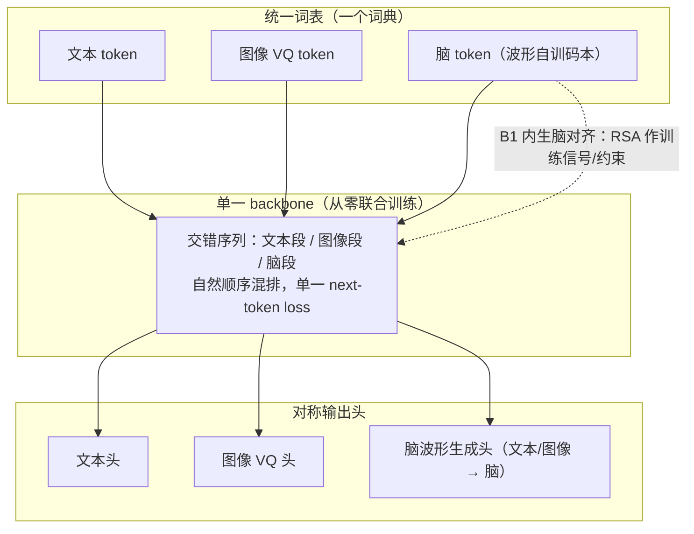

# 脑域线：模型形态判定书

> **状态**：方向判定文档（非论文事实来源）· 起草 2026-10-23
> **定位**：**脑域研究线自己的**形态判定与目标架构。与主线（Hetero-MoE 的跨模型融合）互不框定。
> **证据来源**：`FINDINGS_TIER0_RSA.md` §十六（7 基模脑对齐表，10/10 被试 / 20 Job 全绿；exp75 逐层语义承载曲线）。
> **适用范围**：`research/brain_domains/` 全线；本文档不约束主线，也不被主线的属性反向定义。

---

## 0. 判定原则：形态判定只能由本线自己的目标与数字给出

微软亚研的三层分类（多模态接口 / 多模态对齐与融合 / 原生多模态）与优图的两细分（mid-fusion / early-fusion）
是**通用的描述坐标系**，不是评分表。用它给一条研究线定形态时，有两个必须避开的错误：

| 错误 | 表现 | 纠正 |
|---|---|---|
| **借另一条线的属性** | 用主线的「跨模型融合 / 冻结底座」去定义脑域线的模型形态 | 形态判定用本线自己的**目标**与**实测数字** |
| **把工具阶段当系统形态** | 拿「脑编码器 + 冻结 + 线性读出」这一层的产物去回答「我们的模型将会是？」 | 先分清「这一层在造什么零件」与「这条线最终交付什么模型」 |

本文档的每一条判定后面都跟本线自己的数字，不引用主线的性质。

---

## 1. 两条线的分界（写清不混）

| 维度 | 主线（Hetero-MoE） | **脑域线**（本文档） |
|---|---|---|
| 交付物 | 跨模型融合架构：多个独立训练的模型的可插拔组合 | **脑原生模型** + 脑组件库 + 脑对齐度量体系 |
| 融合发生的层级 | 系统层 / 模型间：拼装已训好的模块 | **模型内**：同一套联合训练权重内部的部件替换 |
| 脑侧角色 | 待接入的模块供给方 | **原生模态**（可训、可读、可生成） |
| 验证标准 | fuse MSE、样本外复验、5 种子配对 | **脑对齐分数**（RSA / 编码 / 解码） |
| 递归的「可插拔」含义 | 多个冻结模型之间换 | 同一套权重内部换 block |
| 继承的纪律 | — | 样本外协议、5 种子配对、负结果地图、单组件可分解（**继承的是纪律，不是形态**） |

> 主线的「冻结底座」是主线的**工程选择**（让每个模块各自最优、组合可复验）；
> 它不是脑域线的形态标签，脑域线不以它为前提，也不以它为禁忌。

---

## 2. 脑域线自己的四条判据（B1–B4）

通用四条（统一词表 / 从零联合训练 / 原生交错单 loss / 输入输出对称）是**必要条件**，对「类脑」不充分。
脑域线另有自己的四条，因为脑域线要回答的是「一个模型怎样才算**脑的**，而不只是『用了 EEG 当输入』」。

| 编号 | 判据 | 本线为何必须有它（自有理由） | 现状（10 被试实测） |
|---|---|---|---|
| **B1 脑对齐内生** | 表征几何与脑响应几何对齐，且这个分数是模型内在属性 | 脑域线唯一的验证标准就是脑对齐分数；主线的 fuse MSE 测不到脑 | ✅ 度量体系齐（指标 A/B） ❌ 现有基模全冻结，且指标 B 全在随机水平 |
| **B2 脑结构承载** | 脑区/功能分工落在**结构**里（层 / block / 专家的分工），不落在输入标签里 | 方向 A 六个实验全否定：脑区标签**可解码但无下游增量价值** ⇒ 标签这条路已死，只能走结构 | ❌ 未做：现在只有「哪层有语义」的读数，没有「按功能分工的结构」 |
| **B3 可生长** | 脑侧参数在联合训练中被改写（可微更新），不是冻结后插上去 | 冻结的脑表征在本线的指标 B 上**全部落在随机水平**（见 §3）⇒ 本线自己的数字就否定了「脑侧只做读出」 | ❌ 全部冻结 |
| **B4 统一表征 + 脑侧对称** | 脑与图/文共享一个表征/词表；脑既能读出语义，也能被语义重建 | 脑域线要的是「脑是**模态**」，不是「脑是特征源」；只读不写，脑就仍是传感器 | 🟡 脑侧离散码本已现雏形（量化码 +0.0155，8/10 显著） |

---

## 3. 现状判定（本线的数字给出的，不含主线属性）

### 3.1 当前阶段在造什么

7 基模 + 冻结 + 线性读出这一层，**不是**脑域线要交付的多模态系统，而是**脑侧零件的解剖标本**：
它回答的是「脑的语义长在模型的哪一层、哪类训练目标会长出语义」。

⇒ 用微软/优图的三层去贴这一层是**分类错误**（把零件目录当系统形态）。

### 3.2 但脑域线自己的表同时给出一条硬约束

| 模型 | 指标 A：r_img（中位） | A 显著 | 指标 B：acc1 | B ×随机 |
|---|---|---|---|---|
| **630-d 原始特征** | **+0.0504** | **10/10** | **0.0111** | **2.2×** |
| signal-jepa | +0.0260 | 9/10 | 0.0056 | 1.1× |
| braintokenizer | +0.0155 | 8/10 | 0.0059 | 1.2× |
| cbramod | +0.0105 | 7/10 | 0.0055 | 1.1× |
| eegdino-small | +0.0063 | 2/10 | 0.0052 | 1.0× |
| mirepnet | +0.0012 | 2/10 | 0.0054 | 1.1× |
| biot | +0.0007 | 5/10 | 0.0049 | 1.0× |

**指标 B 全部落在随机水平（1.0–1.2×），连 630-d 原始特征都做到 2.2×。**
⇒ 冻结的脑表征**装得下**图像语义结构（指标 A 显著），却**不以线性可读的形式保留**它。

**这条否定是脑域线自己跑出来的**（10 被试 / 20 Job 全绿），与主线冻不冻结底座无关：
**脑侧若只被当作冻结特征源，注定被原始特征打败。** ⇒ B3（可生长）不是偏好，是必要条件。

### 3.3 与通用三层的对应（只对「当前这一层」成立）

| | 通用分层 | 我们的位置 |
|---|---|---|
| 第 1 层 | 多模态接口：系统层调不同模型/API 拼能力 | **不是**（我们做的是模型级，不是 API 串联） |
| 第 2 层 | 多模态对齐与融合：编码器独立训练，投影后拼进主干 | **当前落点**（脑侧编码器独立预训练 + 只读出、无端到端、无差分学习率 ⇒ 这一层里偏弱的一种） |
| 第 3 层 | 原生多模态：从第一步起统一表征空间端到端联合训练 | **目标落点**（见 §4） |

### 3.4 一条容易搞错的事

**阶段 C/D 的逐 block 重组不改变层级。** 它搬的是已经训好的权重，
仍然没有端到端联合训练 ⇒ 重组完成后仍在第 2 层。
层级升级只能由 **S2（从零联合训练）**实现，不由组装实现。

---

## 4. 目标形态：**脑原生（brain-native）三模态 born-native**

一句话：**EEG 不是被投影进来的传感模态，而是与文本 / 图像共享同一离散词表、
同一个 next-token loss、同一套可训练权重的原生模态。**

对照通用四条，逐条给出脑域线的具体承诺：

| 通用判据 | 脑域线的具体形式 | 脑侧的新意（相对 Chameleon / Transfusion 家族） |
|---|---|---|
| 统一词表 | 波形 → 离散脑 token，与文本 / 图像 token **同一个词典**（不是投影过去） | **脑 token 的码本是从原始波形学出来的**，且取样层由 exp75 决定（§5.2） |
| 从零联合训练 | 脑编码器在联合训练中**可训练**，不是冻结外挂 | 更进一步：**脑码本可与文本码本联合演化**（Chameleon 的图像 VQ 是单独预训练后冻结）⇒ 脑域线最值得押的一注 |
| 原生交错单 loss | 脑段 / 图段 / 文段按自然顺序混排，**一个 next-token loss** | 交错次序需按脑侧信息密度设计（§5.2） |
| 输入输出对称 | 文本头 + 图像 VQ 头 + **脑波形生成头** | 脑不只是只读传感模态：**文本/图像 → 脑** 也要能生成 |

> 通用四条之外的第五条（**脑域线独有**）：对齐要**内生**（B1）——
> 脑对齐分数不能只在训练完外挂探针才算数，要能反过来当训练信号 / 约束用。

---

## 5. 目标架构（组件级）

### 5.1 骨架

### 5.2 脑侧的四个设计决定（全部来自 exp75，不是设计偏好）

| # | 决定 | 依据 |
|---|---|---|
| 1 | **脑 tokenizer 的取样层不能取最后一层** | cbramod 语义铺满 12 个 block、signal-jepa **只在第 0 层**（+0.0140, p=0.005，第 6 层显著为负 −0.0112 p=0.030）、mirepnet **藏在 FFN 内**（`transformer.1.1.fn` +0.0633, p=0.015）⇒ 「最后一层」代表不了「整个基模」 |
| 2 | **码本优先于连续特征** | braintokenizer 内部连续特征 **0 显著**，而**量化后**的 token 码 +0.0155（8/10 显著）⇒ **离散化本身造出语义对齐** |
| 3 | **重组宿主选 cbramod** | 语义铺满 12 层 ⇒ 拆得动、换得动，换掉一段不会丢失全部 |
| 4 | **供体取「唯一显著处」** | signal-jepa 第 0 层（唯一显著层）/ mirepnet 的 FFN / braintokenizer 的量化码 |

---

## 6. 阶梯 S1–S4（脑域线自己的）

| 级 | 内容 | 判据（可判） | 本线自带的对照基线 |
|---|---|---|---|
| **S1a** | **纯自监督** EEG 离散 tokenizer（掩码重建） | **重建层**的 RSA 显著 + 码本利用率高 | braintokenizer 的**重建输出**（+0.0155，8/10）—— 它的码本**不是**语义载体（见 §6.1） |
| **S1b** | **加语义监督**训码本（图文对比 / 图像条件重建） | **离散层**（码本向量 / one-hot）的 RSA 显著 ⇒ 「统一词表」才成立 | S1a 的离散层读出（实测**不显著**） |
| **S2** | 三模态联合训练（统一词表 / 交错序列 / 单 loss） | 脑-图、脑-文对齐（RSA）；文本/图像能力不塌 | 630-d 原始特征（指标 A +0.0504 / 指标 B 2.2×）与 7 基模冻结表征 |
| **S3** | 对称输出：加脑波形生成头 | 生成波形的可辨识度 / 重建；同一份 EEG 是否被压进更好的码本 | 无（首次） |
| **S4** | 单模态基线 + 涌现性检验 | 脑-only / 图-only / 文-only vs 联合模型；联合模型是否在单模态任务上超过单训模型 | 无（首次） |

每级都过主线的样本外纪律（5 种子配对、负结果地图、单组件可分解）——**继承纪律，不继承形态**。

### 6.1 为什么 S1 必须拆成 a / b 两级（2026-10-23 实测，10 被试）

S1a（纯自监督，掩码重建，K=1024，10 被试中位）的因果分解（`FINDINGS_TIER0_RSA.md` §二十一）：

| 读出 | A r（中位） | 显著被试 |
|---|---:|---:|
| **重建层**（量化→解码的重建 EEG） | **+0.0372** | **10/10** |
| 量化层（码本向量池化） | +0.0045 | 0/10 |
| 离散层（one-hot / 码号） | +0.0014 / +0.0002 | 0/10 / 0/10 |
| 对照 A（不量化的 encoder） | +0.0032 | 1/10 |
| 对照 B（随机码本 + 同 decoder） | +0.0021 | 1/10 |

⇒ **纯自监督学出来的 EEG 离散 token 本身不携带图像语义**；
语义来自「**学出的码本 + 学出的解码器**」这个回路。
⇒ Chameleon 的图像 VQ 之所以天生带语义，是因为「图像」自带语义；
**EEG 没有这个 ⇒ 纯自监督的脑码本不会带语义 ⇒ 统一词表必须靠语义监督（S1b）。**

⇒ 同时给出一条**现成的正结论**：S1a 的**重建层**是高质量脑信号表征
（**+0.0372、10/10 显著**，超过全部 7 个现成基模：signal-jepa +0.0260、
braintokenizer 重建输出 +0.0155、cbramod +0.0105；达到 630-d 原始特征 +0.0504 的 **74%**）
⇒ **可以立刻充当阶段 D 的新供体/宿主**（比 braintokenizer 强 2.4×）。

---

## 7. 阶段 C/D 在脑域线里的位置：**零件资格赛**

| | 内容 |
|---|---|
| **是什么** | 宿主 cbramod 的**最终表征** ⊕ 供体某层表征（表征级拼接），每个变体配一个**同名 shuffle 对照**（供体的图像对应关系被打乱、维度不变）；评价用指标 A（RSA）为主，指标 B 仅用于盯「有没有破坏已有对齐」 |
| **证明什么** | 哪些脑部件**带的信息是真实的**（变体显著优于自己的打乱对照），以及**接进宿主后是提升还是拉低**对齐 |
| **不证明什么** | 不证明原生性、不改变分层（§3.4）、不是最终架构；**也不等于权重级嫁接**（零训练下权重级嫁接已被判死，见下） |
| **与主线的重组有何不同** | 主线的重组是**多个冻结模型之间**换；脑域线的重组必须在**同一套联合训练权重内部**换 ⇒ 阶段 C/D 是这条路的**零件级证据**，不是终点 |

### 7.1 阶段 D 的实测结果（2026-10-23，10 被试 × 2 趟，20 Job）

| 供体 | exp75 的层内 RSA | 接入后 vs 宿主 | 资格赛结论 |
|---|---|---|---|
| **自训 tokenizer 的重建层**（S1a，K=1024） | +0.0372（自身） | **+0.0177，10/10 正，p=0.0010** | ✅ **最佳供体之一** |
| signal-jepa 第 0 层 | +0.0140 | **+0.0178，10/10 正，p=0.0010** | ✅ **完全通过**（与自训重建层几乎等量） |
| braintokenizer 的重建输出 | +0.0155 | +0.0057，7/10 正，p=0.172 | 🟡 部分通过 |
| mirepnet 的 FFN | **+0.0633（exp75 最强）** | **−0.0074，2/10 正** | ❌ **不通过**：接进去**拉低**宿主 |

**⇒ 两条对本阶梯有直接影响的结论：**

1. **「零件资格赛」不可省**：exp75 排第一的供体（mirepnet 的 FFN）接入后**最差**，
   而 exp75 排第三的 signal-jepa 清楚通过 ⇒ 逐层曲线只回答「哪层有语义」，
   **不回答「接进来好不好用」** —— 两者会给出**相反的排序**。
   ⇒ 另需注意：**结论的效应量必须大于可复现性抖动**（实测抖动 ±0.003）
   ⇒ 第一轮那个「v1 边缘通过（Δr=+0.0044，p=0.055）」就是被抖动压低的假象，
   修好后是 **+0.0298（10/10，p=0.0010）**。
2. **自训重建层 ≈ 现成最强基模的层**：两者接入宿主的增益几乎相同
   （+0.0177 vs +0.0178，10/10）⇒ **自监督重建在 460 s 算力内追平了专门训练的基模的内部语义**。
3. **S1 应当走量化/重建路线**（braintokenizer 的语义来自**量化-解码回路**，
   而**码本本身不是语义载体**）⇒ 我们的自训 tokenizer 重建层 +0.0372
   （10/10）比 braintokenizer 的重建输出 +0.0155 强 2.4× ⇒ 直接用作新供体。

⚠️ 同时，结构勘查（exp76）证明：**零训练下 7 基模之间没有任何形状兼容的权重级嫁接**
（648 个可比组合里 compatible=0；token 维两两不同 200/64/256/512，FFN 隐藏维也各不相同）
⇒ **跨模型重组必须训练**（D1 的「两侧学习投影」是必需件，不是可选细节）
⇒ **重组本身不改变原生性层级，层级只能由 S2 获得**。

（数据与口径：`FINDINGS_TIER0_RSA.md` §十七 / §二十一 / §二十二；`results/variant-results/`。）

---

## 8. 本书的证据边界（明确没测的）

| 项 | 状态 |
|---|---|
| 脑侧码本可训练性（码本与文本码本联合演化是否更好） | **未测**，S1/S2 才能测 |
| 「从零联合训练」相对「冻结 + 读出」的增益 | **未测**，S2 的核心对照 |
| 脑波形生成头 | **未测**，S3 |
| 涌现性 | **未测**，S4 |
| 逐层 RSA 的效应量 | 只作**层间排序**筛查（200 图 × 10 重复），不作跨模型结论（§十六·七 口径说明） |
| labram | 本轮排除（128 路 10-10 蒙太奇，THINGS 63 通道插不出） |

---

*本文档只描述脑域线自己的形态判定与目标架构。主线的形态、路线与里程碑见 `docs/ROADMAP.md` 与主线文档；两者互不定义。*
