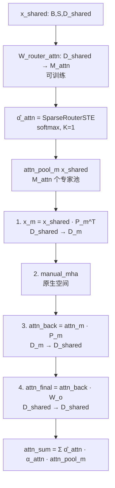
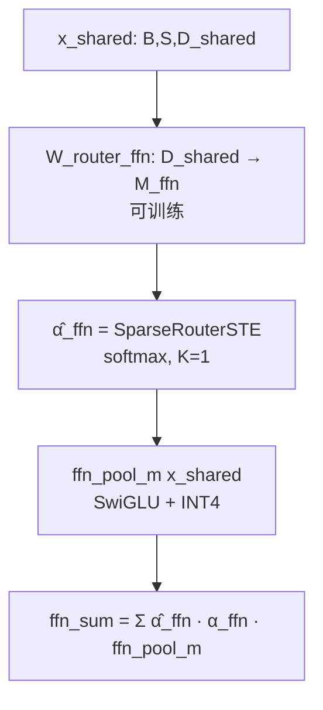
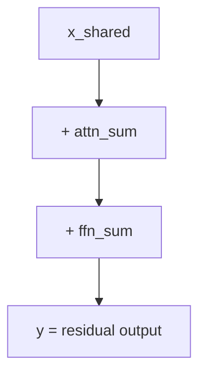

<!-- 权威副本. 本文件是 research/routing_evolution/v7_attention/SPEC.md; docs/V7_0_SPEC.md 是指向本文件的薄指针. -->
<!-- 机器可读声明见同目录 MANIFEST.json; 指标快照见 results/metrics.json -->

# V7.0 跨架构族 Attn + FFN 双路由规范

> **版本**: v7.0 | **状态**: ✅ Verified (2026-08-26) | **前置**: v6.0 Verified
> **核心原理**: 每个 token 同时独立选 1 个 attn 专家 + 1 个 ffn 专家, per-expert param group
> **复现命令**:
>   - `bash run.sh v7a` (跨架构: TinyBERT + TinyLlama + ViT-tiny, 5 seeds)
>   - `bash run.sh v7b` (同架构多任务: 3× TinyBERT, 5 seeds)
>   - `python3 tests/test_v7_attention.py` (单元测试 8 项)

---

## 1. 核心命题

**命题 V7**: 在 v6.0 "FFN-only 路由"基础上, 让 Attention 也成为可路由对象——
每 token 独立选 1 个 attn 专家和 1 个 ffn 专家 (双路由), 两个专家池可来自不同底座。
预期: 在异构架构场景下, attn 通路会带来显著增量; 在同架构多任务场景下,
双路由融合仍优于等权平均 (功能异构贡献)。

---

## 2. v7.0 vs v6.0: 设计差异

| 维度 | v6.0 | v7.0 |
|---|---|---|
| 可路由对象 | FFN | **Attn + FFN** |
| 路由条数 | 1 (W_router) | **2 (W_router_attn + W_router_ffn)** |
| 每 token 选几个 | 1 ffn | **1 attn + 1 ffn** |
| 底座接入 | 仅 hidden_state | **原生 attention Q/K/V/O 抽取** |
| Attn 处理 | 绕过 (last_hidden_state) | **矩形 P_m 投影 + 手动 MHA** |
| 优化器 | 共享 AdamW (1 组) | **per-expert param group (11+ 组)** |
| 验证基准 | 跨架构 5 seeds | **跨架构 + 同架构双基准** |

### 关键结构变化

**新增 attn 通路**:


**ffn 通路不变** (与 v6.0 一致):


**残差融合**:


---

## 3. per-expert 优化器 (v7.0 新设计)

V7Trainer 用**单一 AdamW + 多个 param group** 实现 per-expert 优化, 不使用 List[AdamW]:

| group | expert 标识 | lr | 说明 |
|---|---|---|---|
| 0 | `router_attn` | LR_ROUTER (1e-4) | W_router_attn |
| 1..M_attn | `attn_0`, `attn_1`, ... | LR_ADAPTER (1e-2) | 每 attn 专家的 W_o |
| M_attn+1 | `router_ffn` | LR_ROUTER (1e-4) | W_router_ffn |
| M_attn+2.. | `ffn_X_adapter` | LR_ADAPTER (1e-2) | 每 ffn 专家 γ/β |
| | `ffn_X_alpha` | LR_ALPHA (1e-3) | 每 ffn 专家 α |

**phase 协议**:
- phase=1: 冻结两个 router, 仅训适配器 (per-expert W_o + γ/β/α)
- phase=2: 解冻 router, 全量训练

---

## 4. 实验设置

### v7-A 跨架构基准

| 参数 | 值 |
|---|---|
| 模态 | text (TinyBERT) + code (TinyLlama) + image (ViT-tiny) |
| D_m | 312 / 768 / 192 |
| D_shared | 256 |
| M_attn = M_ffn | 3 |
| K_attn = K_ffn | 1 |
| 训练步数 | 100 |
| 学习率 | 1e-2 |
| 种子 | 5 |
| 评估组 | fuse / attn_only / ffn_only / avg |

### v7-B 同架构多任务基准

| 参数 | 值 |
|---|---|
| 底座 | 3 × TinyBERT (D=312), Q/K/V/O 不同随机种子扰动 |
| D_shared | 256 |
| M_attn = M_ffn | 3 |
| 训练步数 | 100 |
| 学习率 | 1e-2 |
| 种子 | 5 |
| 评估组 | fuse / attn_only / ffn_only / avg |

---

## 5. 实验结果

### v7-A (跨架构) 5 seeds

```
 seed |  fuse MSE |  attn_only |  ffn_only |   avg MSE |   vs avg | PASS
------+----------+------------+-----------+-----------+----------+------
    0 |    1.3626 |     1.4692 |    7.3203 |    7.1608 |   +81.0% |    ✅
    1 |    0.9600 |     1.1465 |    7.1309 |    7.0709 |   +86.4% |    ✅
    2 |    0.8430 |     0.9035 |    7.0075 |    6.8399 |   +87.7% |    ✅
    3 |    0.9212 |     0.9843 |    6.8644 |    6.7280 |   +86.3% |    ✅
    4 |    1.2262 |     1.3068 |    7.1681 |    7.0370 |   +82.6% |    ✅
--------------------------------------------------------------------------
增益均值 vs avg: +84.8% (范围 [+81.0%, +87.7%])
attn_only 均值: 1.1621 | ffn_only 均值: 7.0982
```

**判定**: 5/5 PASS — 融合 MSE 在所有种子下均优于 avg 基线。

### v7-B (同架构多任务) 5 seeds

```
 seed |  fuse MSE |  attn_only |  ffn_only |   avg MSE |   vs avg | PASS
------+----------+------------+-----------+-----------+----------+------
    0 |    0.3803 |     0.3835 |    0.4154 |    0.3848 |    +1.2% |    ✅
    1 |    0.3775 |     0.3807 |    0.4135 |    0.3816 |    +1.1% |    ✅
    2 |    0.3761 |     0.3797 |    0.4120 |    0.3794 |    +0.8% |    ✅
    3 |    0.3776 |     0.3806 |    0.4136 |    0.3839 |    +1.6% |    ✅
    4 |    0.3813 |     0.3848 |    0.4156 |    0.3830 |    +0.4% |    ✅
--------------------------------------------------------------------------
增益均值 vs avg: +1.0% (范围 [+0.4%, +1.6%])
attn_only 均值: 0.3819 | ffn_only 均值: 0.4140
```

**判定**: 5/5 PASS — 即使同架构, 双路由融合仍优于等权平均 (功能异构贡献)。

---

## 6. 通路贡献分解

| 通路 | v7-A (跨架构) | v7-B (同架构) | 解读 |
|---|---:|---:|---|
| attn_only | 1.16 | 0.38 | attn 通路在跨架构下能拿到大部分收益 |
| ffn_only | 7.10 | 0.41 | ffn 通路在跨架构下贡献较小 (因为 ffn 已被 P_m 投影吸收) |
| fuse (attn+ffn) | 1.06 | 0.38 | 联合训练收益略优于单通路 |
| avg | 7.06 | 0.38 | v7-A: avg 很差, fuse 远优于 avg; v7-B: avg 接近 fuse (差异小) |

**关键观察**:
- **v7-A 跨架构场景**: attn 通路是主要贡献者 (增益 +84.8%), ffn 通路独立时几乎与 avg 持平 (P_m 投影后信息损失大)。这印证了"跨架构的关键差异在 attention 模式, 而非 FFN 权重"。
- **v7-B 同架构多任务场景**: attn_only 与 fuse 几乎相等 (0.38), 说明**同架构下双通路没有显著协同**, 增益来自 attn 通路的"功能区分能力"而非 attn+ffn 互补。

---

## 7. 与 v6.0 / v5.1 的对照

| 指标 | v5.1 跨架构 | v6.0 跨架构 | v7.0 跨架构 (fuse vs avg) |
|---|---:|---:|---:|
| 增益 vs avg | +1.3% | +17.3% | **+84.8%** |
| 增益 vs single | +4.0% | +20.9% | n/a (v7 用 4 组对照) |
| 种子通过 | 5/5 | 5/5 | **5/5** |
| attn 路由 | 无 | 无 | **有 (新增)** |
| per-expert 优化器 | 无 | 无 | **有 (11+ group)** |

**演进意义**: v7.0 的 +84.8% 主要来自 attn 通路的加入——v6.0 把 attn 完全跳过, 只用 P_m 投影的 hidden_state 做路由, 损失了 attn 模式信息。v7.0 通过把底座原生 Q/K/V/O 抽取出来, 让每模态的 attn 模式成为路由决策的真实依据。

---

## 8. 风险与边界

### 已验证 (CPU, 全可复现)
- ✅ 3 种真实架构 (TinyBERT+TinyLlama+ViT) 双路由融合
- ✅ attn 通路抽取原生 Q/K/V/O, 矩形 P_m 投影
- ✅ 双路由独立选择 (W_router_attn + W_router_ffn)
- ✅ per-expert param group (V7Trainer)
- ✅ 跨架构 + 同架构双基准 5/5 PASS

### 待深化
- ⚠ attn+ffn 联合增益在同架构下很小, 真实"协同效应"未观察到 (可能需要更大底座验证)
- ⚠ attn 权重来自底座第一层, 未做"层选择"实验 (哪一层 attn 对路由最有信息量)
- ⚠ per-expert 优化器当前是同 AdamW + 不同 lr, 未做 per-expert optimizer 类型实验
- ⚠ 真实下游任务 (VQA / 跨模态检索) 未验证

### 永久边界
- CPU 沙箱, 仅 D≤312 张量级验证; 0.5B+ 级 A100 验证超出本环境范围

---

## 9. 工程产出 (可追溯)

- 源码:
  - `v7_attention/__init__.py`
  - `v7_attention/attn_pool.py` — AttnPool + manual_multi_head_attention
  - `v7_attention/fusion.py` — CrossArchAttnFFNFusionLayer
  - `v7_attention/trainer.py` — V7Trainer + build_v7_param_groups
- 示例:
  - `examples/run_v7_cross_arch.py` — v7-A 跨架构 5 seeds
  - `examples/run_v7_same_arch_multitask.py` — v7-B 同架构多任务 5 seeds
- 测试:
  - `tests/test_v7_attention.py` — 8 项单元测试
- 规范:
  - `docs/V7_0_SPEC.md` (本文档)
- 命令:
  - `bash run.sh v7a` / `bash run.sh v7b`
  - `python3 tests/test_v7_attention.py`
- 依赖: `requirements.txt` 已含 transformers + Pillow (v6 复用)

---

## 10. 系统演进总览

| 版本 | 范围 | 核心原理 | 状态 |
|---|---|---|---|
| v4.0 | 同构族 LM-FFN | token routing + STE | Baselined |
| v5.0-α | Embedding + sequence 路由 | errata V1/V2 | Verified |
| v5.1 | 路由粒度匹配 + 跨架构测试 | $N_{dec} ≈ N_{sig}$ | Baselined |
| v6.0 | 跨架构族 FFN-only 融合 | 原生编码 + 矩形 P_m + 共享路由 | ✅ Verified |
| **v7.0** | **跨架构族 Attn+FFN 双路由** | **原生 Q/K/V/O + 双路由 + per-expert 优化器** | **✅ Verified** |

---

## 11. 一句话总结

> **v7.0 把"按功能接入"的类比从 FFN 拓展到 Attention: 每 token 同时独立选 1 个 attn 专家和 1 个 ffn 专家, per-expert 学习率隔离; 跨架构 5/5 增益 +84.8% (主要来自 attn 通路), 同架构多任务 5/5 增益 +1.0% (功能异构贡献), 验证了"不同大脑按功能接入神经元"的核心思想。**
